# where-were-we

[English](README.md) · [한국어](README.ko.md)

계속 바뀌는 서비스의 코드를 사람과 AI 에이전트가 함께 따라가는 구조 지도입니다.

프로그램·화면·서버 요청·데이터가 어떻게 이어지는지, GitHub에서 진행 중인 작업이 어디서 겹치는지 봅니다. 에이전트도 MCP로 같은 지도를 읽고 계획과 수정에 참고합니다.

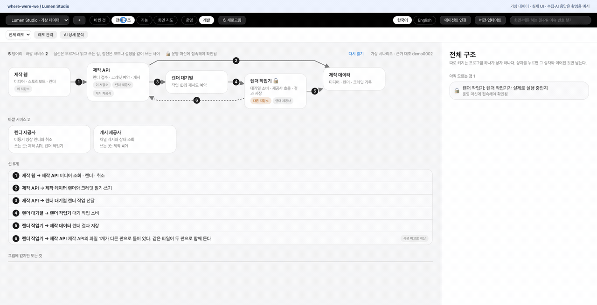

**Lumen Studio**는 미디어·스토리보드·비동기 렌더·게시·워크스페이스 크레딧을 다루는 가상 콘텐츠 제작 플랫폼입니다. 현재 UI를 사용하되 지도·GitHub 작업·테스트 연결·AI 설명·설정 안내는 모두 가상 응답으로 촬영했습니다. 데모에서 실제 수집·AI 분석·테스트 실행·MCP 등록은 하지 않습니다. 실제 서비스 데이터는 쓰지 않았습니다.

## 설치

Apple Silicon Mac, macOS 11 이상, [Homebrew](https://brew.sh/)가 필요합니다. [릴리즈](https://github.com/ganggangstone/where-were-we/releases/latest)에서 ZIP을 직접 받을 수도 있습니다.

```sh
brew install --cask ganggangstone/tap/where-were-we
gh auth login
```

앱에 Python·MCP 라이브러리·수집 스크립트가 들어 있습니다. Homebrew는 git과 GitHub CLI를 함께 설치합니다. AI 기능에는 별도로 설치한 [Claude Code](https://code.claude.com/docs/en/overview)가 필요합니다. MCP를 실행하는 에이전트의 PATH에서도 git·gh와 AI 기능에 쓰는 claude를 찾을 수 있어야 합니다.

**첫 배포 파일에는 코드 서명과 공증이 없습니다.** macOS가 처음 실행을 막을 수 있습니다. Apple의 [확인되지 않은 개발자의 앱 열기 안내](https://support.apple.com/ko-kr/guide/mac-help/mh40616/mac)를 참고하세요. Intel 배포 파일은 없습니다. 실제 앱 창 조작과 다른 Mac에서의 실행은 확인하지 못했습니다.

### 첫 지도 만들기

아직 프로젝트 추가 화면은 없습니다. 앱이 열려 있다면 먼저 종료하세요. `origin/dev`·`origin/main`과 `frontend/src/App.tsx`를 포함한 [지원 구조](#데이터와-한계)의 저장소를 준비하고, 포함된 수집 도구를 한 번 실행한 뒤 앱에서 프로젝트를 고릅니다.

```sh
RUNTIME="/Applications/where-were-we.app/Contents/Resources/runtime"
"$RUNTIME/python/bin/python3" -I -B "$RUNTIME/backend/refresh.py" my-project /path/to/repository
open -a where-were-we
```

`my-project`와 `/path/to/repository`를 원하는 이름과 실제 저장소 경로로 바꾸세요. 위 경로는 앱이 `/Applications`에 있을 때 기준입니다. 수집 도구는 두 원격 브랜치와 GitHub 작업을 읽습니다. 이후 앱의 새로고침 버튼으로 갱신할 수 있습니다. GitHub 로그인에는 해당 저장소를 읽을 권한이 필요합니다.

앱은 한국어로 시작합니다. 상단 **English**로 바꾸면 선택을 이 기기에 저장합니다. UI와 새로 요청한 에이전트 연결·테스트 안내문은 선택한 언어를 따릅니다. 프로젝트 이름·코드·AI 설명은 원문을 유지합니다. 이미 열어 둔 안내문은 다시 요청하기 전까지 그대로 둡니다.

## 지도 둘러보기

### 바뀐 것

새로 생기거나 사라진 화면·요청·이동 경로, 병합 PR과 바뀐 AI 근거를 봅니다.

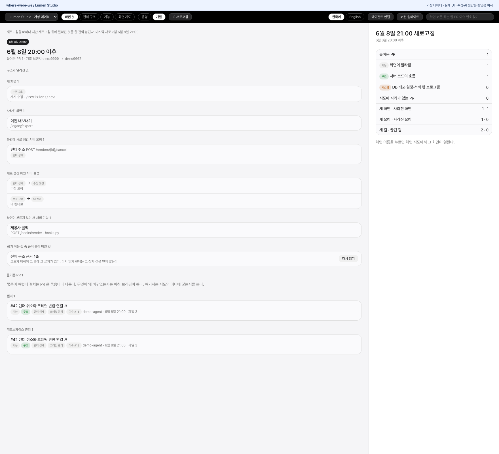

### 전체 구조

프로그램·대기열·공유 데이터·외부 서비스와 실제 실행 환경에서 확인할 내용을 봅니다.

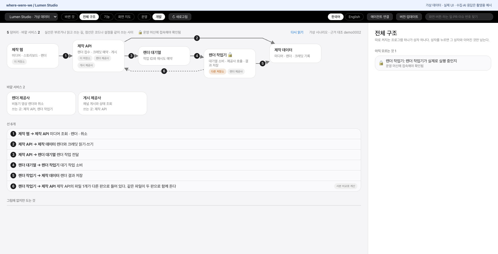

### 기능

화면을 하는 일로 묶고 기능 사이의 연결을 따라갑니다.

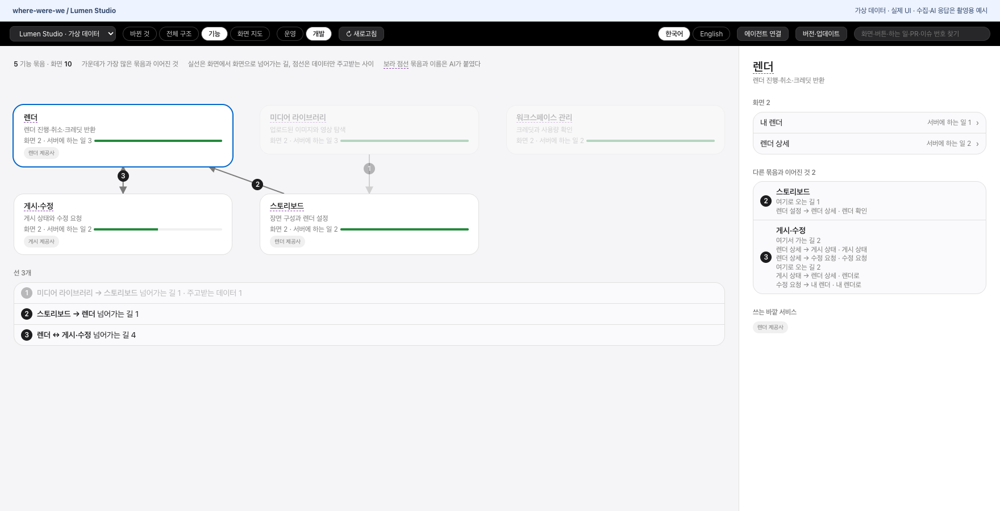

### 화면 지도와 진행 중인 작업

서버 요청·테스트·dev/main 차이, 겹치는 PR·PR 없는 브랜치·작업 폴더·연결된 이슈를 봅니다.

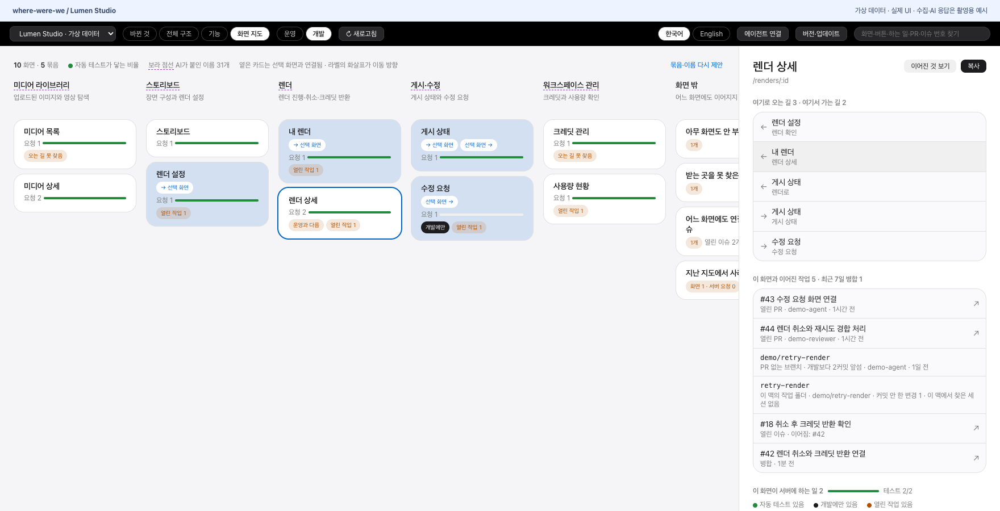

### 요청 뒤의 순서

취소 요청·외부 호출·상태 변경·크레딧 반환을 따라갑니다. 이어지는 작업기의 일도 따로 표시합니다.

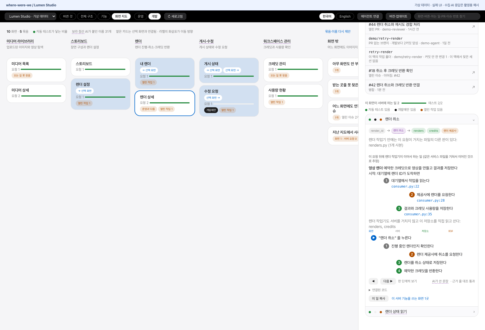

### 이어진 것

화면이나 요청 하나를 가운데 두고 부르는 곳·데이터·외부 서비스를 봅니다.

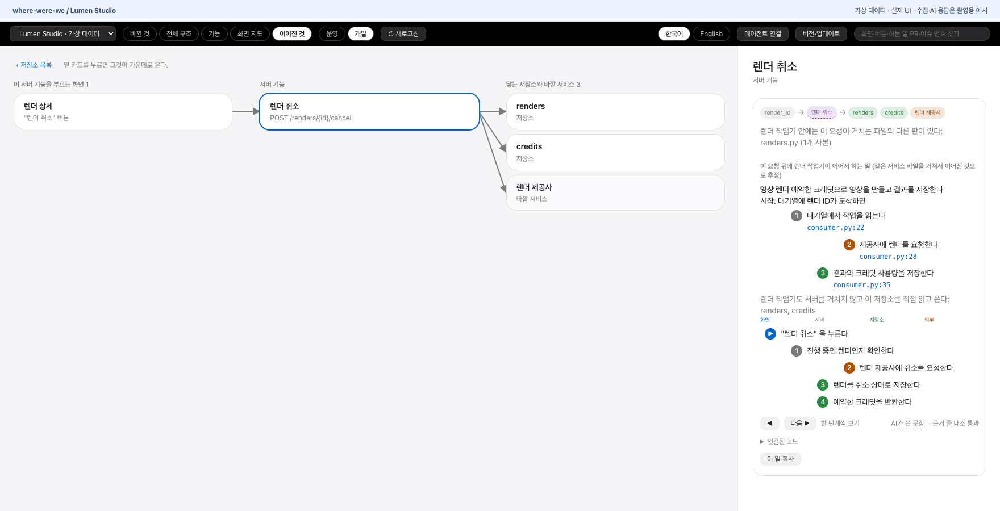

### 공유 데이터의 영향

같은 데이터를 쓰는 화면과 작업기를 찾습니다. 읽기·변경은 GET과 나머지 HTTP 방식으로 구분하므로 실제 부수 효과까지 판별하지는 못합니다.

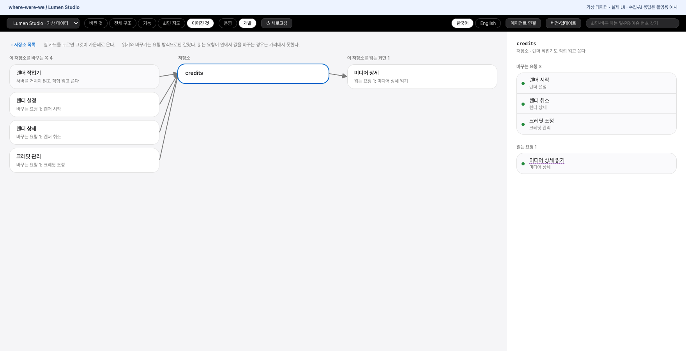

### 작업기와 코드 사본

백그라운드 작업·직접 쓰는 데이터·원본 브랜치와 다른 코드 사본·운영 환경의 미확인 내용을 봅니다.

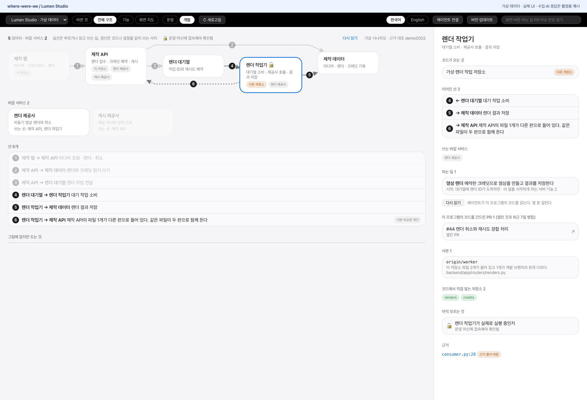

### 테스트 연결 찾기

에이전트가 테스트를 찾아 반복되는 규칙이나 개별 근거 줄을 등록하도록 안내를 복사합니다. 연결하지 못했다는 것이 테스트가 없다는 뜻은 아닙니다.

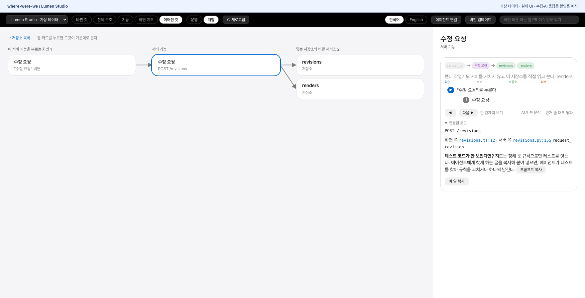

### 에이전트 연결

설치된 실행 환경에 맞는 MCP 연결 안내를 만듭니다. 에이전트가 설정 변경 내용을 먼저 보여 주고 허락을 받도록 안내합니다.

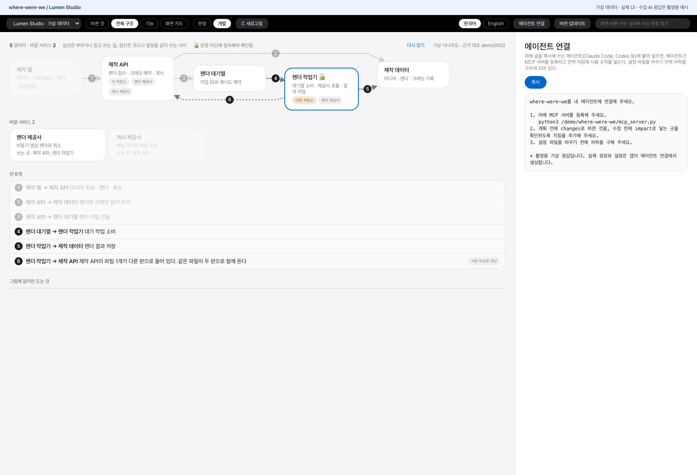

### 버전과 업데이트

설치 버전·최신 정식 릴리즈·한영 노트를 확인하고 Homebrew 업데이트 명령을 복사합니다.

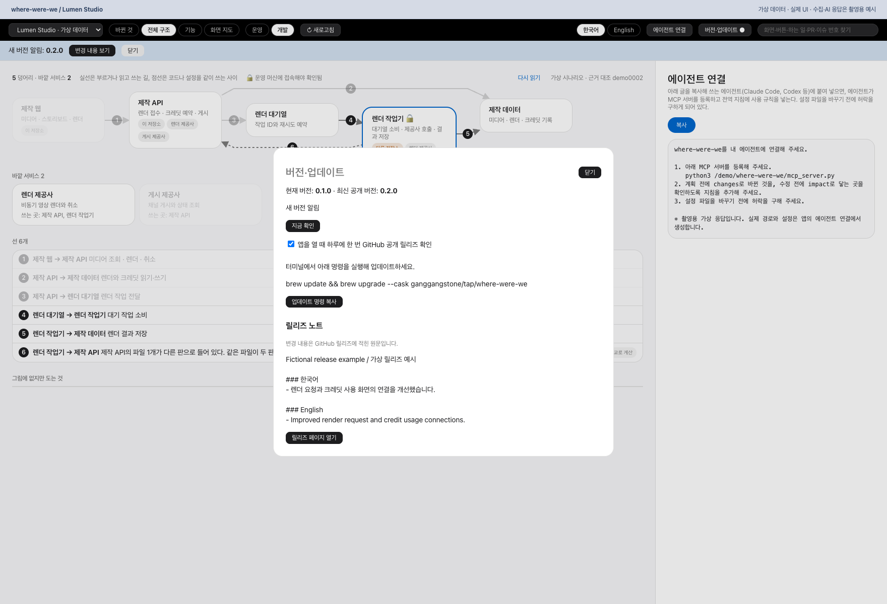

<details>
<summary>더 보기: 미연결 항목·사라진 항목·검색</summary>

**화면과 연결되지 않은 서버 기능**

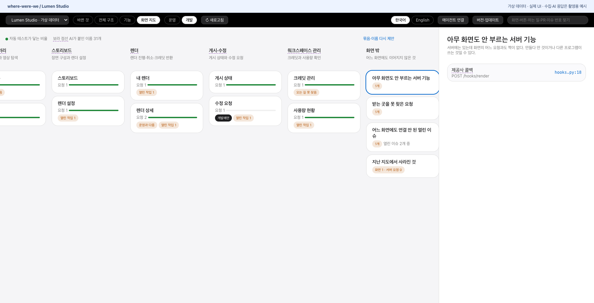

**받는 곳을 못 찾은 요청**

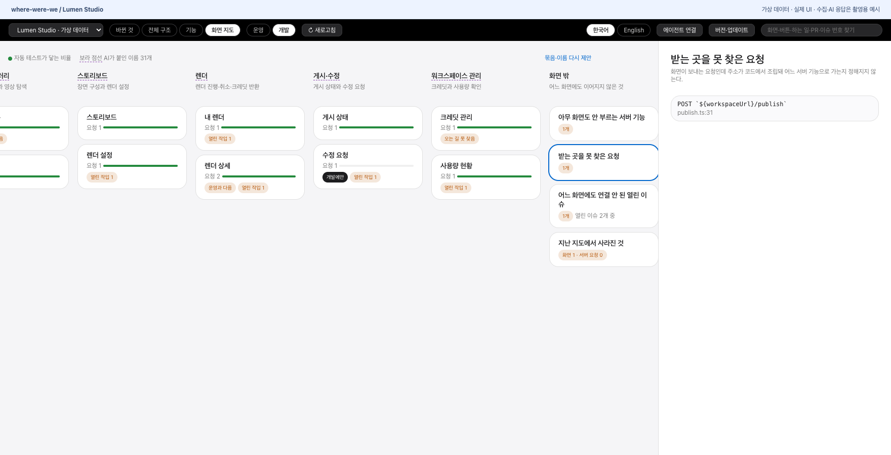

**화면과 연결되지 않은 이슈**

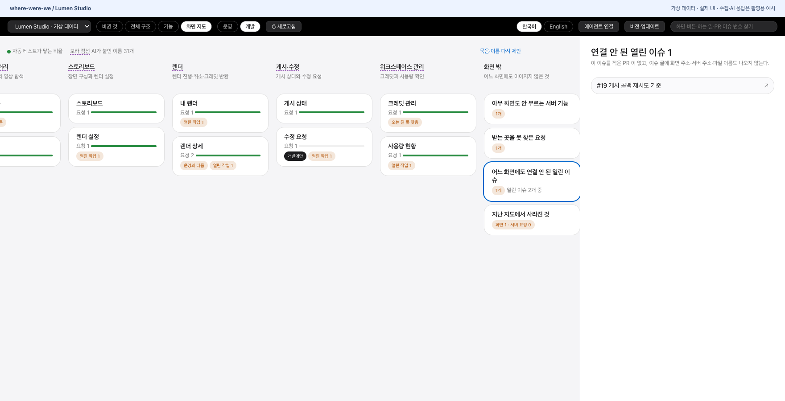

**지난 지도에서 사라진 화면과 요청**

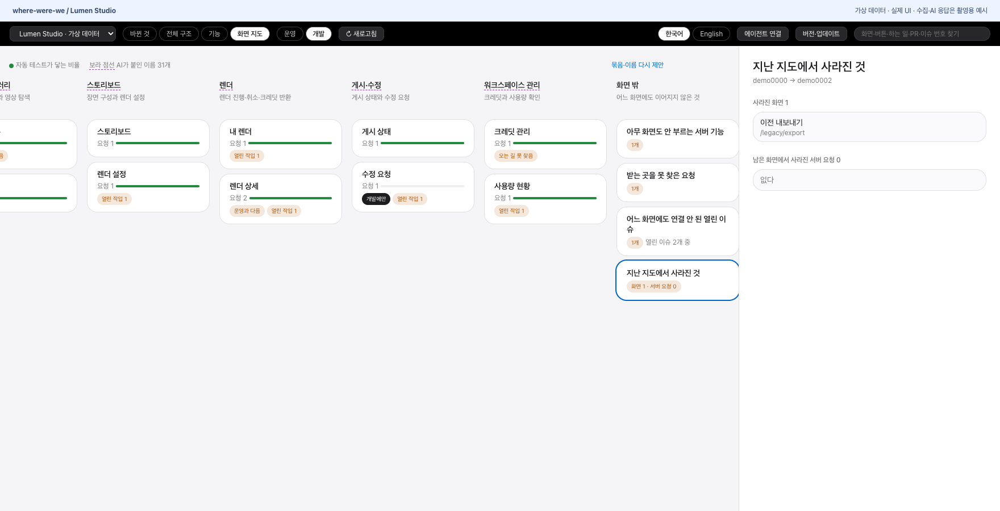

**화면·버튼·요청·PR·이슈 검색**

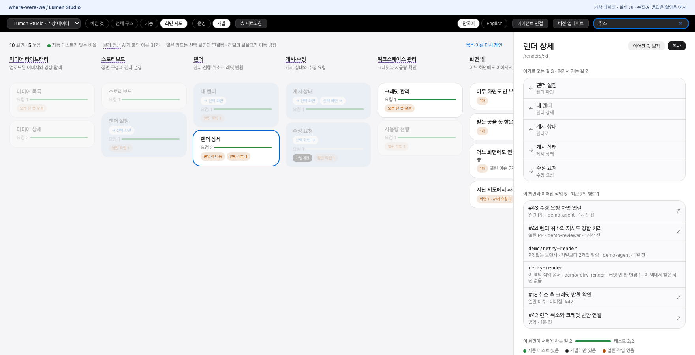

</details>

## 에이전트와 함께 쓰기

**에이전트 연결**을 누르고 안내를 복사해 Claude Code·Codex 등 MCP를 지원하는 에이전트에 전달합니다. 안내에는 설정을 바꾸기 전 허락을 구하고, 지도 확인 시점과 계획에 적을 내용을 사용자에게 묻도록 되어 있습니다.

도구는 `projects`, `changes`, `impact`, `overview`, `find`, `refresh`, `set_test_rules`, `record_test`입니다. 계획 전 `changes`, 수정 전 `impact`를 불러 닿는 화면·요청·데이터와 겹치는 작업을 확인합니다. AI 설명의 인용문이 해당 근거 줄과 일치하는지 대조하지만, 설명의 의미나 시스템 전체 동작의 정확성을 보증하지는 않습니다.

## 업데이트

앱을 열 때 GitHub의 공개 릴리즈를 24시간에 최대 한 번 확인합니다. 자동 확인을 끄거나 직접 조회할 수 있습니다. 실패하면 이전 정보를 유지하며 최신 버전이라고 표시하지 않습니다. 릴리즈 노트는 일반 텍스트로 표시합니다. 버전 조회 요청에는 지도·코드·GitHub 로그인 토큰을 넣지 않습니다.

업데이트는 터미널에서 실행합니다.

```sh
brew update && brew upgrade --cask ganggangstone/tap/where-were-we
```

앱은 명령만 복사하며 설치나 재시작을 자동으로 하지 않습니다. 새 릴리즈가 Homebrew에 반영되기까지 시간이 걸릴 수 있습니다. 앱을 제거해도 `~/.where-were-we/`의 지도는 남습니다.

## 데이터와 한계

- 지도는 `~/.where-were-we/`에 둡니다. 프로젝트 구조가 들어 있으므로 공개 저장소에 넣지 마세요.
- 수집 도구는 `git fetch`를 실행하고 로컬 파일·git 이력·GitHub 작업·작업 폴더·확인 가능한 로컬 Claude Code 세션 메타데이터를 읽습니다. 다른 브랜치로 이동하거나 대상 저장소의 파일을 수정하지 않습니다.
- 명시적으로 요청한 AI 기능은 설치된 `claude -p`를 실행합니다. 코드 일부와 화면 정보가 입력에 들어갈 수 있으며, 처리·전송은 해당 클라이언트의 서비스와 설정을 따릅니다.
- 상세 추출은 React Router, `frontend/src/api`의 axios, `backend/app/routers`의 FastAPI, `backend/app/models`의 SQLAlchemy 구조를 가정합니다. 다른 구조에는 추출기 수정이 필요합니다. 전체 구조·PR 정보와 상세 화면 추출은 별개입니다.
- `dev`와 `main`은 코드 브랜치 비교입니다. 실제 배포 상태를 확인하는 것은 아닙니다. git에 없는 프로그램과 실행 상태는 실제 환경을 확인하기 전까지 미확인으로 남습니다.
- 테스트나 이동 경로를 잇지 못한 것은 추출기가 그 모양을 인식하지 못해서일 수도 있습니다. 후보 이슈·추정 연결은 확정 사실과 구분해 읽어야 합니다.

## 개발과 빌드

소스에서 수집하려면 Python 3.11 이상과 위의 외부 명령이 필요합니다.

```sh
git clone https://github.com/ganggangstone/where-were-we.git
cd where-were-we
python3 -m venv .venv
.venv/bin/pip install "mcp>=2,<3"
.venv/bin/python refresh.py my-project /path/to/repository
```

macOS 앱을 빌드하려면 Python 3.12 이상, Rust, Tauri CLI 2가 추가로 필요합니다. 아키텍처별 해당 Mac에서 빌드합니다. 패키징 도구는 교차 빌드와 universal 빌드를 지원하지 않습니다.

```sh
python3 scripts/prepare-runtime.py --build --release-preview --target aarch64-apple-darwin --no-sign
```

도구는 Python과 [라이브러리 고정 목록](requirements-runtime.lock)의 해시를 확인하고 구성 요소별 라이선스 고지를 보존합니다. Rust 의존성의 빌드 머신 홈 경로를 제거하고 허용 목록에 든 백엔드 파일만 포함합니다. 생성된 실행 환경·개인 지도·빌드 산출물은 git에 넣지 않습니다. 명령은 실제 ZIP 해시·설치 정의·한영 노트를 출력하며 게시하지는 않습니다. `--no-sign`은 서명 없는 빌드를 만듭니다.

```sh
python3 ui/check_tokens.py
WHERE_WERE_WE_RUNTIME=src-tauri/runtime python3 -m unittest discover -s tests -p test_packaging.py -v
cargo test --manifest-path src-tauri/Cargo.toml --lib
```

실행 환경 검사는 앱을 공백이 있는 경로로 옮기고 빈 홈·제한된 PATH에서 원본 코드와 시스템 Python 없이 MCP 초기화·도구 목록·프로젝트 조회를 확인합니다. 하위 프로세스 인자는 가짜 호출로 검사합니다. 실제 비공개 프로젝트 수집·AI 분석·사용자의 에이전트 설정 변경을 검증하는 검사는 아닙니다.

ZIP과 한영 노트를 먼저 공개하고, [설치 정의 원본](Casks/where-were-we.rb)의 실제 해시를 [공용 Homebrew tap](https://github.com/ganggangstone/homebrew-tap)에 반영합니다. 검증한 배포 파일이 있는 아키텍처만 게시합니다. 공통 디자인 기준은 [DESIGN.md](DESIGN.md)에 있습니다.

## 데모 다시 촬영하기

[fixture.cjs](docs/demo/fixture.cjs)는 한국어·영어 가상 프로젝트를 만듭니다. [capture.cjs](docs/demo/capture.cjs)는 현재 `ui/`를 브라우저에서 열고 Tauri 응답을 가상 데이터로 대신합니다. 촬영 도구가 추가하는 것은 안내 배너와 커서뿐입니다. 실제 프로젝트 지도나 에이전트 설정은 읽지 않습니다.

Node.js와 FFmpeg를 설치한 뒤 실행합니다.

```sh
npm install --prefix docs/demo --no-save playwright@1.64.0
cd docs/demo && npx playwright install chromium && cd ../..
node docs/demo/capture.cjs --en
node docs/demo/capture.cjs
node docs/demo/capture.cjs --check-language
node docs/demo/capture.cjs --check-updates
```

언어마다 `docs/images/en/` 또는 `docs/images/ko/`에 GIF 1개와 PNG 16개를 만듭니다. GIF는 전체 구조 → 기능 → 화면 지도 → 렌더 취소 → 데이터 영향 → 바뀐 것 순서입니다. 브라우저 오류나 예상하지 않은 외부 요청이 생기면 촬영이 실패합니다. 가상 응답의 렌더링·클릭 동작을 확인하며 실제 백엔드 응답을 검증하지는 않습니다.

## 기여와 라이선스

버그·개선 제안은 [원본 저장소의 이슈](https://github.com/ganggangstone/where-were-we/issues)로 보내 주세요. 재현 순서·기대한 동작·실제 결과를 함께 적어 주세요. 원본 프로젝트에 PR로 기여할 수 있습니다. 기여하려는 큰 변경은 구현 전에 범위를 논의해 주세요. 제출이 답변·반영·지원·출시 일정을 보장하지는 않습니다.

[별도의 소스 공개 라이선스](LICENSE)는 조건에 따라 개인·회사 내부 사용과 원본·수정판의 무료 재배포를 허용하며, 유료 제품·외부 유료 서비스를 제한합니다. 이슈·PR 제출이나 수정 소스 공개 의무는 없습니다. MIT·Apache·OSI 오픈소스 라이선스는 아닙니다. 제삼자 구성 요소의 별도 라이선스는 유지되며, 라이선스는 영어 본문이 기준입니다.

## v0.1.0 릴리즈 노트

한영 릴리즈 노트의 정본은 [영문 README의 릴리즈 노트](README.md#v010-release-notes)에 있습니다. 앱에서도 두 언어의 원문을 볼 수 있습니다.
