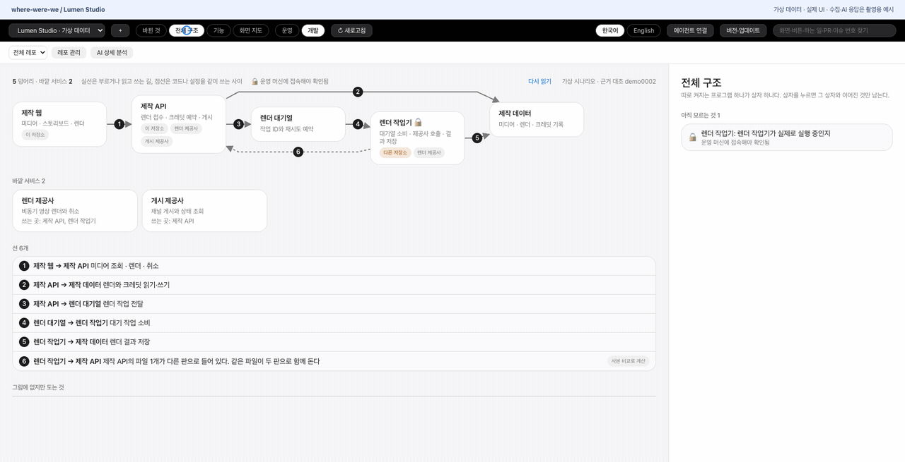
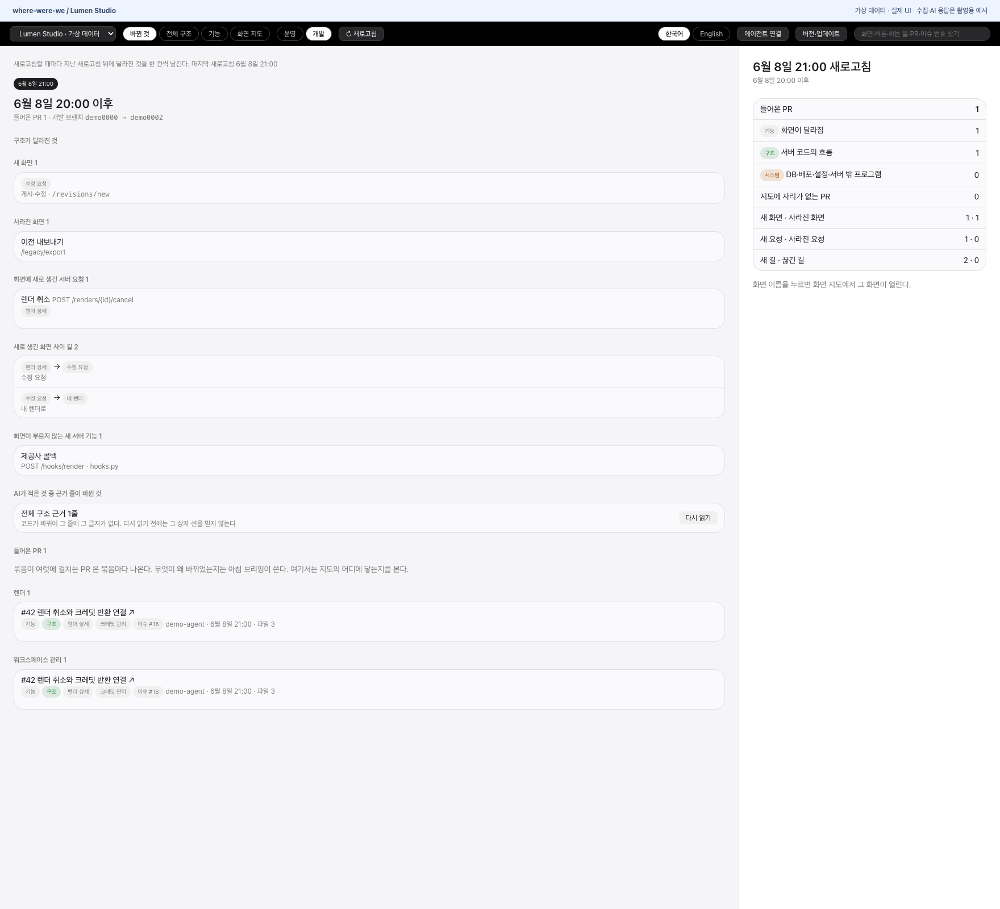
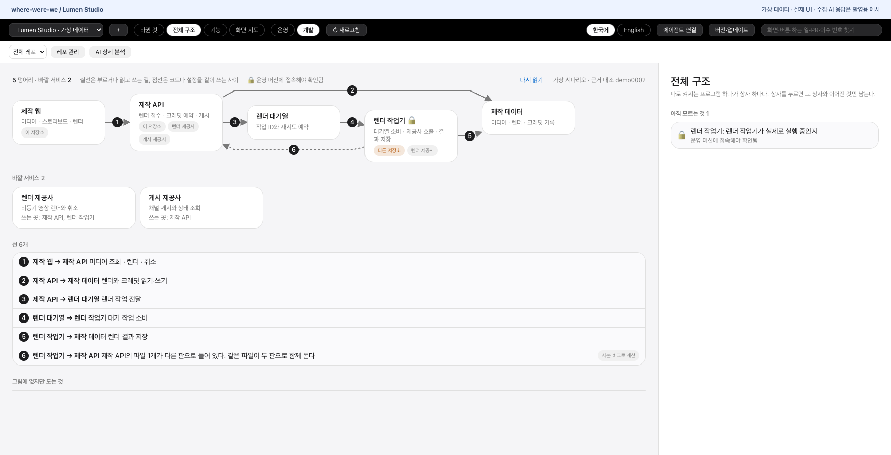
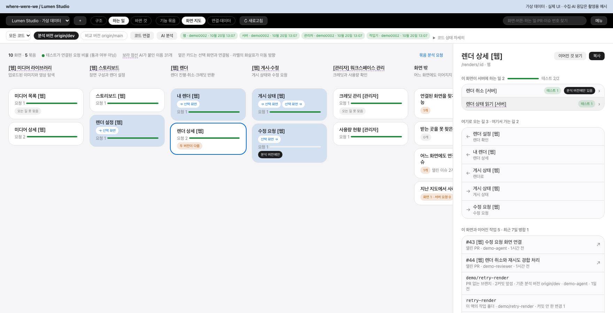
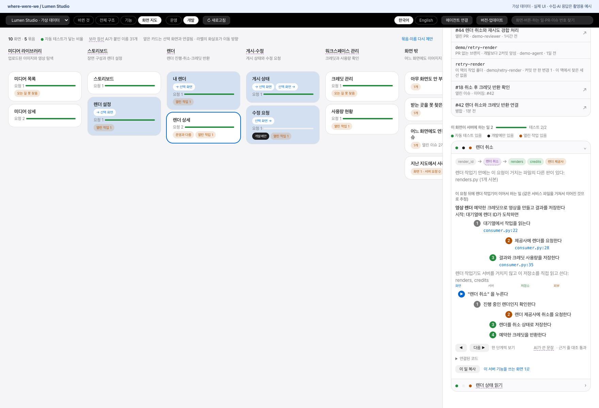
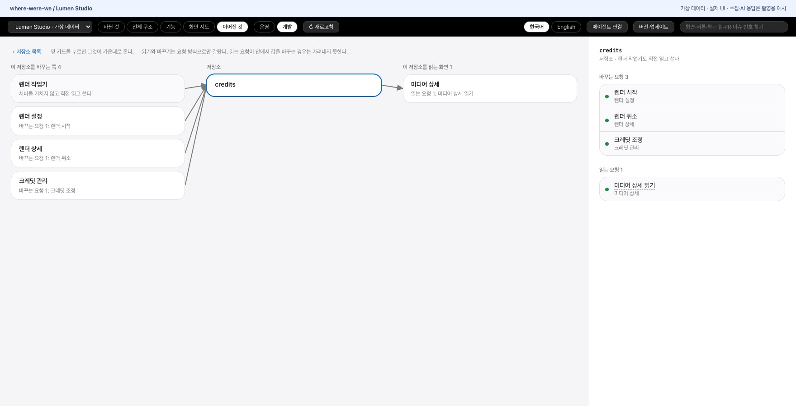

# where-were-we

[English](README.md) · [한국어](README.ko.md)

서비스가 어떻게 이어지는지, 무엇이 바뀌었는지 보고 하던 일을 이어갑니다.

한 프로젝트에 여러 저장소를 연결해 화면·서버 요청·프로그램·공유 데이터를 함께 봅니다. AI 에이전트도 같은 지도를 읽고, 대화 중인 기능을 앱에서 찾아 표시할 수 있습니다.



실제 앱에 가상 서비스 **Lumen Studio**의 데이터를 넣어 촬영했습니다.

## 설치

Apple Silicon Mac과 macOS 11 이상이 필요합니다.

```sh
brew install --cask ganggangstone/tap/where-were-we
gh auth login
```

[Homebrew](https://brew.sh/)가 필요한 Git과 GitHub CLI를 함께 설치합니다. [릴리즈](https://github.com/ganggangstone/where-were-we/releases/latest)에서 ZIP을 직접 받을 수도 있습니다. ZIP 설치에는 Git과 GitHub CLI가 별도로 필요합니다.

앱은 Apple의 개발자 서명·공증을 받지 않았습니다. macOS가 첫 실행을 막으면 Apple의 [확인되지 않은 개발자의 앱 열기 안내](https://support.apple.com/ko-kr/guide/mac-help/mh40616/mac)를 참고하세요.

## 시작하기

1. 앱을 여세요. 처음 설치하면 **시작 안내**가 열립니다(**메뉴 → 시작 안내**에서 다시 열 수 있습니다).
2. **작업하던 AI에 연결 맡기기:** 요청 하나를 복사해 서비스를 만들 때 쓰던 AI 채팅(Claude Code·Codex 등 MCP를 지원하는 에이전트)에 붙여 넣으세요. 이 요청 하나로 연결, 서비스 저장소 확인, 첫 지도, 첫 AI 분석까지 이어집니다. AI는 연결 설정을 바꾸기 전에 허락을 받고, 저장할 코드·첫 수집·첫 분석을 한 번에 확인받습니다. 분석은 그 AI의 모델로 실행되므로 그 AI의 요금과 사용 한도가 적용되며, 분석만 거절하고 지도만 쓸 수도 있습니다. 요청을 두 번 복사할 필요는 없습니다.
3. **연결한 저장소**에서 저장소마다 위치와 지도 준비 여부를 확인하세요. 저장된 프로젝트를 고치려면 **연결한 저장소 수정**을, 새 프로젝트를 직접 입력할 때만 **직접 연결하기**(다른 프로젝트는 상단 **＋**)를 쓰세요.
4. 마지막 단계는 **첫 분석**입니다. 모든 저장소에 앱 언어로 쓴 현재 버전의 AI 분석이 저장돼야 끝나며, 기본 지도만으로는 끝나지 않습니다. AI가 끝나면 앱으로 돌아오세요. 저장된 결과를 앱이 스스로 읽고(**결과 확인**으로 직접 읽을 수도 있습니다), **분석 결과 보기**가 분석된 구조를 엽니다. 일부만 저장됐으면 그렇게 표시하고, **남은 분석을 AI에 맡기기**로 이어갈 수 있습니다. AI가 도구를 쓰려고 새 세션이 필요하면 멈추고 알려 주며, 이미 저장된 결과는 그대로 남습니다.
5. GitHub 주소로 연결하면 첫 지도를 가져옵니다. 로컬 폴더를 연결했다면 **새로고침**을 누릅니다. **구조** 또는 **하는 일**에서 결과를 봅니다. 분석 전에도 연결한 저장소나 최상위 폴더와, 수집한 커밋 기준으로 확인한 서버 경로·명령·모듈을 볼 수 있습니다. 구문 분석을 지원하지 않는 저장소도 Git 추적 폴더와 파일을 탐색할 수 있습니다. 이름·묶음·서비스 구성이 필요하면 **분석하기**를 누릅니다.

한 프로젝트에 저장소를 여러 개 연결할 수 있습니다. 선택 상자의 **모든 저장소**는 연결한 저장소 전체를 한 지도로 보여 주고, 저장소 하나를 고르면 그 저장소의 화면만 보이되 지정한 서버 연결은 그대로 이어집니다. 서로 요청을 주고받는다면 **저장소 추가·수정**에서 각 저장소의 **이 저장소가 쓰는 서버**를 고를 수 있습니다(**서버 연결 지정**으로도 엽니다). 지도에서 관계를 잇는 설정일 뿐이며, 주소가 같다는 이유만으로 서로 다른 저장소를 잇지 않습니다. 앱이 연결 후보를 보여 주면 확인한 뒤 **지도에 연결**을 누를 수 있습니다.

GitHub 연결은 원격 기본 브랜치를, 기존 폴더는 커밋된 코드를 읽습니다. 다른 브랜치나 태그를 보려면 **저장소 추가·수정**의 **지도에 표시할 브랜치**에서 선택하세요. 상단 **표시 브랜치** 버튼 두 개에는 실제 브랜치·태그 이름이 적혀 있습니다. 코드 존재 여부를 비교할 뿐 배포 상태를 뜻하지 않습니다.

**메뉴 → 설정**에서 언제부터 바뀐 내용을 볼지 정할 수 있습니다. 설정은 모든 서비스에 적용되며, **저장하고 새로고침**으로 바로 반영할 수 있습니다. **마지막 새로고침 뒤**를 고르면 다음 새로고침은 이번 새로고침 시각 이후부터 비교하고, **고른 시각부터**는 설정을 바꾸기 전까지 시작점이 유지됩니다. **서비스를 열 때 새로고침**은 다른 서비스로 바꿀 때도 실행됩니다.

앱은 한국어로 시작합니다. **메뉴**에서 **English**로 바꾸면 언어 선택을 저장합니다.

## AI 에이전트와 함께 쓰기

### 앱에서 분석하기

**분석하기**는 AI로 저장소 지도를 만드는 하나의 동작입니다. 시작하기 전에 버튼에 AI 호출 횟수가 표시됩니다(**분석하기 · 호출 N회**). 먼저 로컬 지도를 계산해 바로 보여 주고, AI는 소스 파일이 아니라 그 지도의 요약을 보고 단위 이름을 붙이고 화면을 묶고 서비스 구성을 그립니다. 답이 올 때마다 저장하며, 다시 누르면 빠졌거나 코드가 바뀐 부분만 다시 합니다. 내장 읽기 규칙이 없는 언어는 읽기 규칙을 받는 호출이 한 번 더 듭니다.

단위 하나의 설명은 요청할 때만 만듭니다. 연 카드의 **AI 설명**, 화면 요청의 **이 동작의 과정 알아보기**, 프로그램의 **이 프로그램이 하는 일 알아보기**, **바뀐 것**의 **변경 설명 만들기**가 그렇습니다. 각각 호출 횟수를 알리고 읽은 코드 줄을 근거로 붙입니다.

**자동 분석 (베타)**은 로그인된 Claude Code 구독을 쓰며 지원되는 Claude Code CLI가 필요합니다. Claude 사용 한도와 조직 정책이 적용됩니다. 패널을 열거나 새로고침할 때는 AI를 호출하지 않습니다. 다른 에이전트를 쓰려면 같은 패널의 **AI 채팅에 요청**을 열어 요청을 복사하세요.

### MCP 에이전트에 요청 전달

**메뉴 → AI 연결**을 누르고 안내를 Claude Code·Codex 등 MCP를 지원하는 에이전트에 전달하세요. AI 연결을 설정하고 공통 지시 파일에 사용 규칙을 추가하며, 바꾸기 전에 확인을 요청합니다.

앱을 열고 **“업로드 재시도 기능이 지도에서 어디인지 보여 줘”**라고 말해 보세요. 에이전트가 대상을 찾아 강조하고, 앱에서 직접 선택한 대상도 읽습니다. 계획하거나 수정하기 전에 지도를 확인해 영향받는 곳과 겹치는 작업을 살펴보도록 요청할 수 있습니다.

더 자세한 분석이 필요하면 **분석하기 → AI 채팅에 요청**을 여세요. 요청 하나로 상세 지도, 서비스 구성과 프로그램별 하는 일, 화면 묶음, 동작 과정, 변경 설명을 함께 정리합니다. 이미 저장된 최신 결과는 다시 분석하지 않습니다.

1. 요청을 복사하세요.
2. 작업하던 AI 채팅에 붙여 넣고, AI가 코드를 분석해 결과를 저장할 때까지 기다리세요.
3. AI가 끝나면 앱으로 돌아오세요. 저장된 결과를 앱이 스스로 읽습니다(**결과 확인**으로 바로 읽을 수도 있습니다). 다른 화면을 보다가 돌아올 때는 **분석하기**로 같은 요청을 다시 엽니다.

저장된 결과를 읽어도 **바뀐 것**과 비교 기준은 유지됩니다. 분석은 연결한 AI가 하며, 사용하는 AI의 요금·사용 한도가 적용됩니다. 일반 새로고침은 AI 분석을 실행하지 않습니다. 첫 분석은 기본 수집이 이미 찾은 것을 AI가 다시 쓰지 않고 그대로 두며, 앱은 그 부분을 기본 수집으로 표시합니다. 일반적인 부분 변경이면 코드가 바뀐 뒤의 요청에 바뀐 파일과 그 파일을 근거로 삼은 저장 항목만 들어가고, AI가 그것만 답하면 나머지 저장된 분석은 그대로 남습니다. AI가 바뀐 파일을 분류하지 못하면 아무것도 저장하지 않고, 다음 요청은 저장된 것을 다시 쓰게 하지 않은 채 코드 전체를 다시 확인합니다. 파일이 똑같은 커밋은 새 분석이 필요 없습니다.

업데이트 뒤 도구가 보이지 않으면 **연결 진단**에서 수정 요청을 복사해 AI에게 보내세요. 다시 연결한 뒤 **연결됐는지 확인**을 누르세요. 에이전트의 새 세션이 필요할 수도 있습니다.

## 지도 둘러보기

상단의 세 보기 **구조 · 하는 일 · 바뀐 것**으로 서비스를 살펴봅니다. **하는 일** 안에서 **기능 묶음 · 화면 지도 · 연결·데이터**를 고릅니다. 상단 검색은 어느 보기에서든 화면·서버 기능·프로그램·데이터·기능과 화면에 이어진 PR·이슈 번호를 찾습니다.

### 바뀐 것

바뀐 화면·서버 요청·병합 PR을 보고, 변경마다 제목과 어떤 문제를 풀었는지 한 줄로 적은 카드를 읽습니다. **변경 설명 만들기**로 앱이나 AI 채팅이 카드를 씁니다. 설명을 요청하거나 결과를 읽어도 비교 기준은 유지됩니다.



### 구조

**분석하기** 뒤에는 저장소마다 한 칸에 그 저장소의 프로그램을 놓고, 마지막 칸에 외부 서비스를 둡니다. 프로그램 사이 선은 코드의 import나 요청 줄이 보여 줄 때만 그리고, 선마다 그 코드를 적습니다. 분석 전에는 저장소나 최상위 폴더와 서버 경로를 보여 줍니다.



에이전트가 저장한 AI 제안은 직접 작성한 구조를 바꾸지 않습니다. **AI 제안**을 눌러 따로 볼 수 있습니다.

### 화면 지도와 진행 중인 작업

**하는 일 → 화면 지도**에서 서버 요청·테스트·두 버전의 차이, 겹치는 PR·PR 없는 브랜치·작업 폴더·연결된 이슈를 봅니다.



### 요청 뒤의 순서

화면을 고르고 **이 동작의 과정 알아보기**를 누르면 단계를 **화면 · 서버 · 데이터 · 외부 서비스** 칸에 나눠 놓습니다. 단계는 그 화면의 코드와 이어지는 서버 코드를 읽고 쓰며, 단계마다 근거 코드 줄을 붙입니다. **한 단계씩 보기**로 차례로 따라갈 수 있습니다. 이어지는 작업기의 일도 따로 표시합니다.



### 공유 데이터의 영향

같은 데이터를 쓰는 화면과 작업기를 찾습니다.



### 그 밖의 화면

항목마다 같은 가상 프로젝트의 화면 이미지를 링크했습니다.

- **기능 묶음:** **하는 일 → 기능 묶음**에서 화면을 하는 일로 묶고 기능 사이의 연결을 따라갑니다. 기능을 고르면 그 기능의 화면, 서버에 하는 일, 이어진 열린 작업·최근 7일 병합 PR·브랜치·작업 폴더·이슈를 함께 보여 주고, **기능 복사**로 AI에게 넘길 수 있습니다. **화면 지도에서 보기**를 누르면 지도 전체는 그대로 두고 그 기능의 화면만 강조합니다. 화면을 고르거나 **연결·데이터**에서 서버 기능·데이터를 열면 상세 위에 고른 기능과의 관계를 표시하고 **‹ 기능 개요**와 **기능 선택 해제**를 둡니다. 서버에 하는 일이 8개를 넘으면 나머지는 **더**를 펼쳐 바로 엽니다. [화면 보기](docs/images/ko/features.png)
- **연결·데이터:** **하는 일 → 연결·데이터**에서 화면이나 요청 하나를 가운데 두고 부르는 곳·데이터·외부 서비스를 봅니다. [화면 보기](docs/images/ko/connections.png)
- **작업기와 코드 사본:** 백그라운드 작업·직접 쓰는 데이터·원본 브랜치와 다른 코드 사본·운영 환경의 미확인 내용을 봅니다. [화면 보기](docs/images/ko/worker.png)
- **테스트 연결:** **AI에게 테스트 찾기 요청**으로 AI가 테스트를 찾아 반복되는 규칙이나 개별 근거 줄을 등록하도록 요청을 복사합니다. 확인하려고 새로고침할 수 있습니다. 연결하지 못했다는 것이 테스트가 없다는 뜻은 아닙니다. [화면 보기](docs/images/ko/tests.png)
- **AI 연결:** **메뉴 → AI 연결**에서 설치된 실행 환경에 맞는 MCP 연결 안내를 만듭니다. 에이전트가 설정 변경 내용을 먼저 보여 주고 허락을 받도록 안내합니다. [화면 보기](docs/images/ko/agent-setup.png)
- **버전·업데이트:** **메뉴 → 버전·업데이트**에서 설치 버전·최신 정식 릴리즈·한영 노트를 확인하고 **지금 업데이트**로 Homebrew 업데이트를 설치합니다. [화면 보기](docs/images/ko/updates.png)
- **지도의 빈틈:** 화면과 연결되지 않은 서버 기능([화면 보기](docs/images/ko/orphan-requests.png)), 받는 곳을 못 찾은 요청([화면 보기](docs/images/ko/unresolved-requests.png)), 화면과 연결되지 않은 이슈([화면 보기](docs/images/ko/unlinked-issues.png)), 지난 지도에서 사라진 화면과 요청([화면 보기](docs/images/ko/removed-items.png))을 봅니다.
- **검색:** 지도가 있는 서비스라면 어느 보기에서든 화면·기능·프로그램·데이터·PR·이슈를 찾습니다. [화면 보기](docs/images/ko/search.png)

## 저장소 추가·수정 도움말

- **수집에 실패했을 때:** **GitHub 계정 바꾸기**에서 로그인된 계정을 선택하고 다시 시도하세요. 저장소마다 계정을 기억하며, 새로고침에 실패해도 마지막 성공 지도는 유지됩니다.
- **여러 저장소가 같은 데이터베이스를 쓸 때:** **저장소 추가·수정 → 같은 데이터베이스를 함께 쓸 때**에서 테이블을 연결하세요. 이름이 같은 테이블을 자동으로 합치지는 않습니다.
- **다른 저장소의 서버로 요청할 때:** **저장소 추가·수정**의 **이 저장소가 쓰는 서버**에서 선택하세요.
- **연결을 해제할 때(이 저장소 연결 해제):** 내려받은 코드와 저장된 지도는 Mac에 남습니다.

## 업데이트

Homebrew로 설치했다면 **메뉴 → 버전·업데이트 → 지금 업데이트**를 누르세요. 새 버전 알림의 **업데이트 보기**는 이 창을 열 뿐 바로 설치하지 않습니다. 설치 뒤 앱이 다시 열리고, 저장된 지도는 유지됩니다. 업데이트가 끝나면 에이전트의 MCP도 재연결하세요.

터미널에서 업데이트하려면 다음 명령을 실행하세요.

```sh
brew update && brew upgrade --cask ganggangstone/tap/where-were-we
```

새 버전 알림은 **메뉴 → 버전·업데이트**에서 끌 수 있습니다. ZIP으로 설치했다면 [릴리즈](https://github.com/ganggangstone/where-were-we/releases/latest)에서 최신 ZIP을 받으세요.

**업데이트가 중단됐을 때**

설치나 실행에 실패하면 이전 앱 복구를 시도합니다. 복구도 중단됐다면 아래 명령으로 복구 안내를 여세요.

```sh
open -a TextEdit ~/.where-were-we/.app-update.log
```

보관한 앱의 위치와 재설치 명령이 적혀 있습니다. Finder로 앱을 복원하거나 안내된 명령을 실행하세요.


## 데이터와 분석 범위

- 지도와 내려받은 코드는 `~/.where-were-we/`에 저장합니다. 프로젝트 정보가 들어 있으므로 공개 저장소에 넣지 마세요.
- 수집은 코드·Git 이력·GitHub 작업을 읽습니다. 원격 변경을 가져오지만 작업 중인 브랜치를 바꾸거나 소스 파일을 수정하지 않습니다.
- AI 분석 때는 연결한 에이전트에 소스 코드를 제공합니다. 데이터 처리는 선택한 에이전트·제공자의 설정을 따릅니다.
- 자동 수집은 React Router/axios·FastAPI·SQLAlchemy를 지원합니다. 다른 언어·프레임워크는 에이전트에 분석을 요청하세요. 표시된 분석 범위·미확인 항목·원문 근거를 함께 확인하세요.
- 브랜치 비교는 코드의 차이를 보여 줍니다. 실제 배포 상태나 실행 환경을 확인한 결과는 아닙니다.

## 기여와 라이선스

버그·개선 제안은 [이슈](https://github.com/ganggangstone/where-were-we/issues)로 보내 주세요. PR도 환영합니다. 큰 변경은 구현 전에 범위를 논의해 주세요.

[라이선스](LICENSE)는 조건에 따라 개인·회사 내부 사용과 무료 재배포를 허용하며, 유료 제품·외부 유료 서비스를 제한합니다. 별도의 소스 공개 라이선스이며, 제삼자 구성 요소에는 각각의 라이선스가 적용됩니다.

**v0.11.0 릴리즈 노트**

### 한국어

- **분석하기** 하나로 어떤 저장소든 지도를 만듭니다. 시작 전에 AI 호출 횟수를 보여 주고, 답이 올 때마다 저장하며, 다시 누르면 빠졌거나 바뀐 부분만 다시 합니다. 단위별 자세한 설명은 요청할 때만 만듭니다.
- **구조**는 저장소마다 한 칸, 외부 서비스는 마지막 칸으로 그립니다. 프로그램 사이 선은 코드의 import나 요청 줄이 보여 줄 때만 그립니다.
- **하는 일**에서 기능 묶음·화면 지도·데이터를 그림과 한 줄 설명으로 먼저 보여 줍니다.
- **이 동작의 과정 알아보기**는 단계를 화면·서버·데이터·외부 서비스 칸에 나눠 보여 줍니다. 화면 단계는 그 화면의 코드에서 쓰고, 단계마다 근거 코드 줄을 붙입니다.
- **바뀐 것**은 변경마다 제목과 한 줄 설명을 담은 카드로 보여 줍니다.
- 앱의 문구를 저장소·서버 요청·서버 경로·외부 서비스 같은 용어로 맞추고 더 쉽게 고쳤습니다.
- 이전 버전에서 저장한 AI 설명은 다음 **분석하기**에서 다시 만듭니다. 이때 연결한 AI의 사용량이 듭니다.
- 저장소 하나로 만든 이전 프로젝트는 처음 열 때 자동으로 옮깁니다. 이전 파일은 따로 보관합니다.
- 앱은 Apple 개발자 서명·공증을 받지 않았습니다. macOS가 첫 실행을 막으면 README의 설치 안내를 참고하세요.

### English

- **Analyze** is now the one action that maps any repository. It shows the number of AI calls before it starts, saves each answer as it arrives, and on the next press redoes only what is missing or changed. Detailed explanations of single units are made only when you ask.
- **Structure** draws one lane per repository and a last lane for external services. Lines between programs appear only where import or request lines in the code show them.
- **What it does** opens features, the screen map and data with a picture and a one-line explanation.
- **Explain this action step by step** places the steps in Screens, Server, Data and External services lanes. Screen steps are written from that screen's own code, and every step cites its code line.
- **Changes** shows each change as a card with a title and one line.
- App wording now uses consistent terms such as repository, server request, server route and external service, and is simpler throughout.
- AI explanations saved by earlier versions are made again on the next **Analyze**, which uses your connected AI's quota.
- Projects made with one repository in earlier versions are moved automatically the first time you open them. The old files are kept aside.
- The app is not signed with an Apple Developer ID or notarized. If macOS blocks the first launch, see the install section of the README.

[전체 릴리즈](https://github.com/ganggangstone/where-were-we/releases) · [설정과 구현 상세](docs/MULTI_REPO_SPEC.md)
