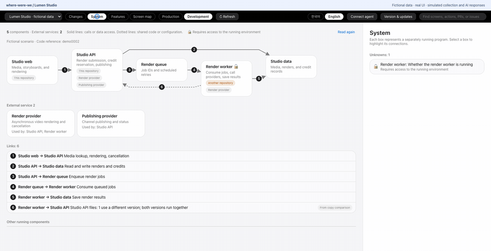
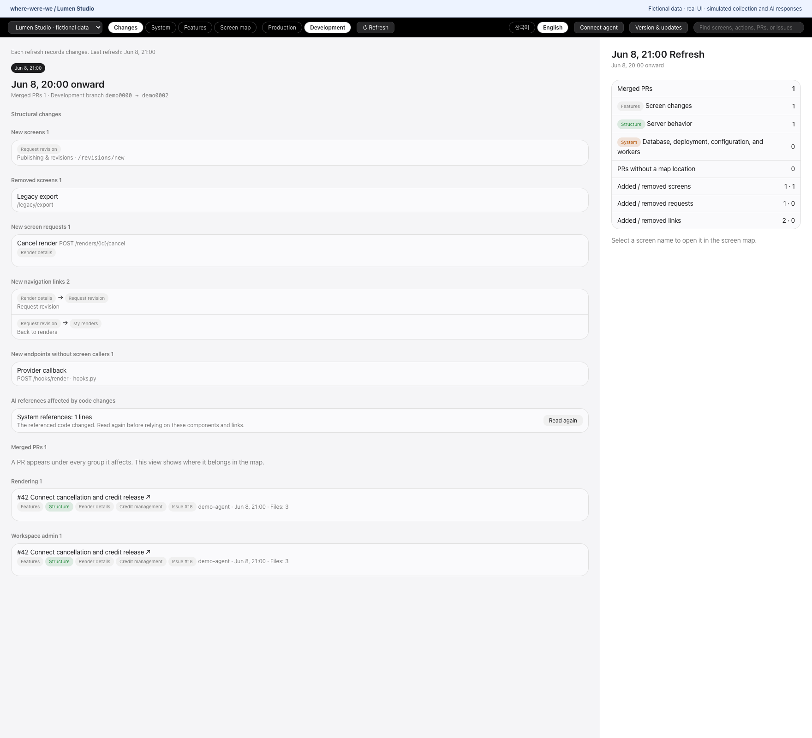
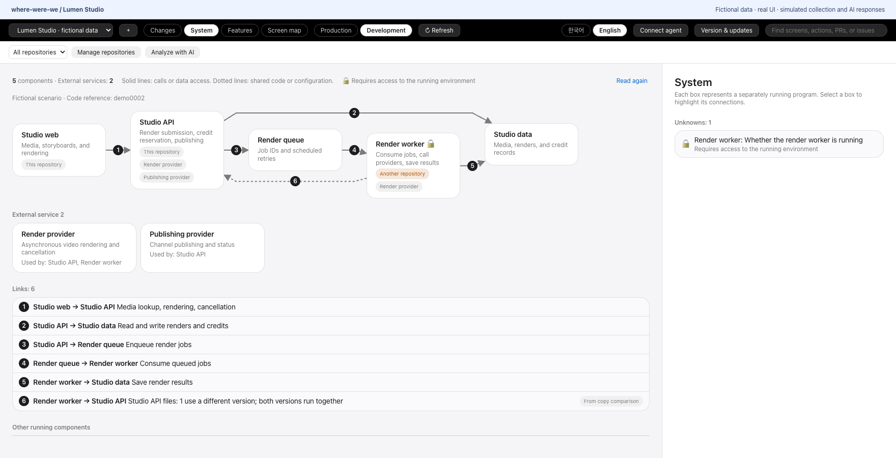
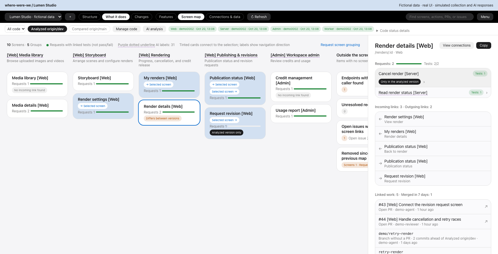
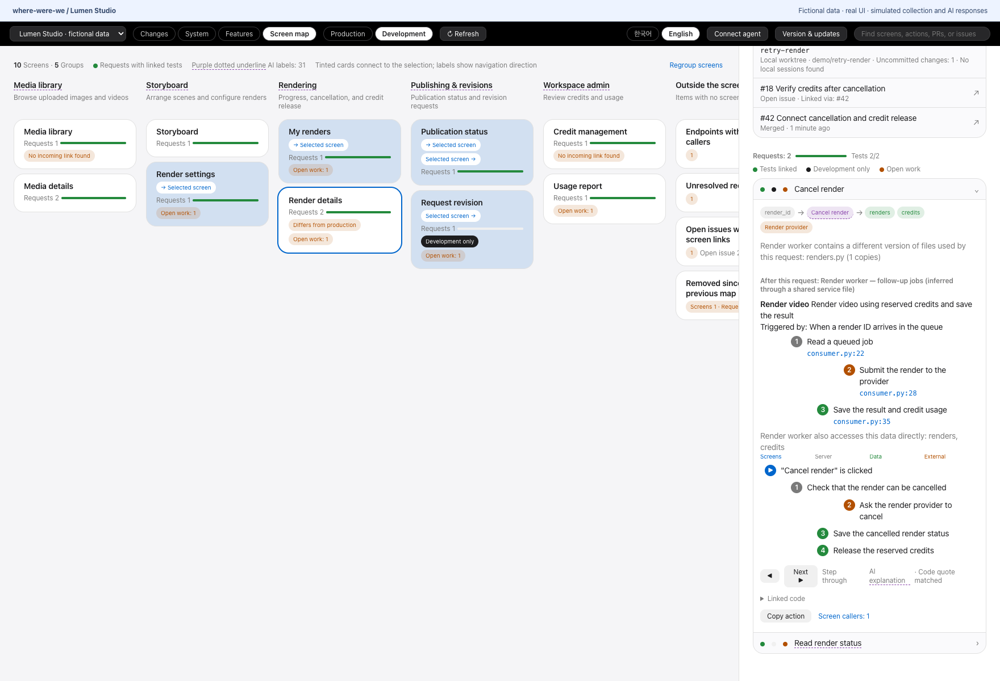
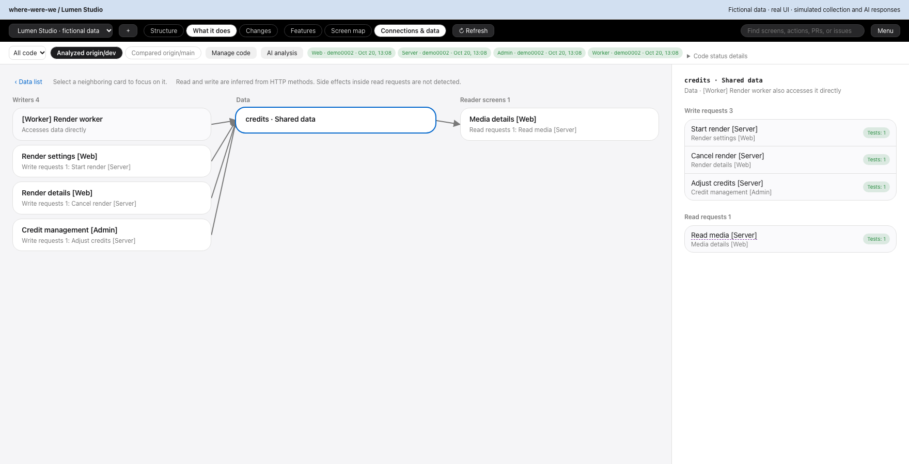

# where-were-we

[English](README.md) · [한국어](README.ko.md)

Explore your codebase with visual architecture maps, change tracking, and impact analysis. Available as a local desktop app and MCP server for AI agents.

Connect several repositories to one project to explore their screens, server requests, programs and shared data. Your AI agent can read the same map and highlight what you are discussing in the app.



Screenshots show the real app with fictional **Lumen Studio** data.

## Install

Requires an Apple Silicon Mac and macOS 11 or later.

```sh
brew install --cask ganggangstone/tap/where-were-we
gh auth login
```

[Homebrew](https://brew.sh/) installs the required Git and GitHub CLI. You can also download the app from [Releases](https://github.com/ganggangstone/where-were-we/releases/latest); ZIP installations need Git and GitHub CLI installed separately.

The app does not have Apple Developer ID signing or notarization. If macOS blocks its first launch, follow Apple's [instructions for opening an app from an unidentified developer](https://support.apple.com/guide/mac-help/open-a-mac-app-from-an-unknown-developer-mh40616/mac).

## Get started

1. Open the app. The **Getting started** guide opens on a new install (reopen it from **Menu → Getting started**).
2. **Ask your AI to connect:** copy the one request into the coding AI chat you build the service with (Claude Code, Codex or another MCP-compatible agent). That single request covers the connection, the service's repositories, the first map and the first AI analysis. Your AI asks before it changes its connection settings, and asks you once to confirm the code to save, the first collection and the first analysis. The analysis runs with your AI's own model, so its pricing and usage limits apply; you can decline it and keep the map. You do not copy a second request.
3. In **Connected repositories**, check each repository's location and whether its map is ready. Use **Edit connected repositories** to fix a saved project; use **Connect manually** only to enter a project yourself (**＋** in the toolbar for a further project).
4. **First analysis** is the last step. It is finished only when every repository has a saved AI analysis in the app's language for its current version; a basic map alone is not. When your AI is done, return to the app: it reads the saved results by itself (or click **Check results**) and **View the analysis** opens the analyzed structure. If only part was saved, the step says so and **Ask your AI to finish the analysis** continues it. If your AI needs a new session for its tools, it stops and tells you; what it already saved is kept.
5. A GitHub connection collects its first map when connected. For a local folder, click **Refresh**. Open **Structure** or **What it does** to see the results. Before any analysis, the map shows the connected repositories or top-level folders and the source-backed server routes, commands or modules it can verify at the collected commit. Other projects can still be browsed by tracked folder and file. Click **Analyze** when you want names, groups and the service structure.

A project can connect several repositories. **All repositories** in the selector shows every connected repository on one map; choosing one repository shows only its screens while its configured server links stay. If repositories call each other's servers, choose each one's **Servers this repository uses** in **Add or edit repositories** (or click **Set server connections**). This only links them on the map; matching addresses alone do not link different repositories, and when the app shows candidates you can confirm them with **Link on map**.

GitHub connections follow the remote default branch. Local folders use committed code. Choose other branches or tags under **Branch shown on the map** in **Add or edit repositories** when needed. The two **Map branch** buttons below the toolbar are labelled with the actual branch or tag names. They compare code, not deployment state.

In **Menu → Settings**, select when the change comparison should start. Settings apply to all services; **Save and refresh** applies them right away. With **Since the last refresh**, the next refresh compares changes since this refresh; **Since the selected time** stays fixed until you change it. **Refresh when opening a service** also runs when you switch to another service.

The app starts in Korean. Choose **English** in the **Menu** to save your language preference.

## Use your AI agent

### Analyze from the app

**Analyze** is the one action that maps a repository with AI. Its button states the number of AI calls before you start (**Analyze · N calls**). The local map is calculated first and shown right away; then the AI names the units, groups the screens and draws the service structure from a summary of that map, not from source files. Each answer is saved as it arrives, and pressing **Analyze** again redoes only the parts that are missing or whose code changed. Languages without a built-in reader get one extra call for reading rules.

Explanations of single units are made only when you ask: **AI explanation** on an opened card, **Explain this action step by step** for a screen's requests, **Analyze this program’s jobs** for a program and **Explain changes** in **Changes**. Each states its calls and cites the code lines it used.

**Automatic analysis (beta)** uses the signed-in Claude Code subscription and requires a supported Claude Code CLI. Your Claude usage limits and organization policy apply. Opening the panel and refreshing the map make no AI calls. To use another agent, open **Ask in your AI chat** in the same panel and copy the request.

### Send a request to an MCP agent

Click **Menu → Connect your AI** and copy the instructions into Claude Code, Codex or another MCP-compatible agent. It sets up the connection and adds usage rules to its global instructions, asking before it changes anything.

With the app open, try: **“Show me the upload retry feature in where-were-we.”** Your agent can find and highlight it, and read what you select in the app. Ask it to consult the map before planning or editing to find affected areas and overlapping work.

For a closer look, open **Analyze → Ask in your AI chat**. One request covers the detailed map, architecture and program jobs, screen groups, action steps, and change explanations. Current saved results are reused.

1. Copy the request.
2. Paste it into your coding AI chat and let it analyze the code and save its results.
3. Return to the app when your AI is done: it reads the saved results by itself (**Check results** reads them on demand). After browsing elsewhere, **Analyze** reopens the same request.

Reading saved results preserves **Changes** and its comparison baseline. Your connected AI runs the analysis and its pricing and usage limits apply; ordinary refresh does not run AI analysis. The first analysis keeps what the basic collection already found instead of having your AI write it again, and the app labels those parts as basic collection. For an ordinary partial change, the next request lists only the changed files and the saved items that cite them; your AI answers those, and the rest of the saved analysis stays as it was. If the AI cannot classify a changed file, nothing is saved and the next request reviews the whole code again without rewriting what is saved. A commit with identical files needs no new analysis.

If tools are missing after an update, open **Connection diagnostics**, copy the repair request to your AI, and click **Check the connection** after it reconnects. You may need a new agent session.

## Explore the map

The three toolbar views are **Structure · What it does · Changes**. **What it does** contains **Features · Screen map · Connections & data**. Search works in every view and finds screens, endpoints, programs, data, features, and PR or issue numbers linked to screens.

### Changes

See changed screens and server requests and merged PRs, and read each change as a card with a title and one line about the problem it solved. Choose **Explain changes** to have the app or your AI chat write the cards. These actions keep your comparison baseline unchanged.



### Structure

After **Analyze**, each repository is a lane of the programs it holds, with external services in a last lane. A line between programs is drawn only where import or request lines in the code show it, and each line lists that code. Before analysis, the view shows the repositories or top-level folders and their server routes.



An AI proposal saved by your agent never replaces the written structure. Choose **AI proposal** to view it separately.

### Screen map and ongoing work

In **What it does → Screen map**, see requests, tests, differences between the analyzed and compared versions, overlapping PRs, branches without PRs, local work folders, and linked issues.



### Follow a request

Select a screen and click **Explain this action step by step**. The steps are placed in **Screens · Server · Data · External services** lanes and written from the screen's own code and the server code it reaches, each with the code line it cites. Use **Step through** to follow them one by one. Background work is distinguished from the request itself.



### Shared data impact

Find screens and workers touching the same data.



### More views

Each item links to a screenshot of the same fictional project.

- **Features:** in **What it does → Features**, group screens by purpose and follow connections across features. Choosing a feature shows its screens, server requests, and linked open work, PRs merged in the last 7 days, branches, work folders, and issues; **Copy feature** copies them for your AI. **Show on the screen map** keeps the whole map and highlights that feature's screens; when you pick a screen, or open a request or data in **Connections & data**, its details show how it relates to the feature, with **‹ Feature overview** and **Clear feature**. Beyond the first eight requests, the rest open from **more**. [Screenshot](docs/images/en/features.png)
- **Connections & data:** in **What it does → Connections & data**, focus on one screen or request and see its callers, data, and external services. [Screenshot](docs/images/en/connections.png)
- **Workers and copied code:** inspect background jobs, directly accessed data, copied files that differ from the source branch, and unverified operational details. [Screenshot](docs/images/en/worker.png)
- **Missing test links:** **Ask your AI to find tests** copies a request for your AI to locate tests and register repeatable patterns or individual verified lines; it may refresh to check them. Missing links do not establish that tests are absent. [Screenshot](docs/images/en/tests.png)
- **Connect your AI:** in **Menu → Connect your AI**, generate MCP registration instructions for the installed runtime. Ask the agent to show proposed configuration edits and request permission. [Screenshot](docs/images/en/agent-setup.png)
- **Version & updates:** in **Menu → Version & updates**, view the installed version, stable releases, and bilingual notes; install Homebrew updates with **Update now**. [Screenshot](docs/images/en/updates.png)
- **Map gaps:** server requests with no mapped screen ([screenshot](docs/images/en/orphan-requests.png)), requests whose destination cannot be resolved ([screenshot](docs/images/en/unresolved-requests.png)), issues with no screen link ([screenshot](docs/images/en/unlinked-issues.png)), and screens and requests removed since the previous map ([screenshot](docs/images/en/removed-items.png)).
- **Search:** find screens, features, programs, data, PRs and issues from any view once a service has a map. [Screenshot](docs/images/en/search.png)

## Connection help

- **Collection failed:** use **Change GitHub account** to select a saved login and retry. Each repository remembers its own account; the previous successful map stays available if a refresh fails.
- **Several repositories use one database:** map their table names under **Add or edit repositories → When repositories share a database**. Equal table names alone do not connect them.
- **A request belongs to another repository:** choose it under **Servers this repository uses** in **Add or edit repositories**.
- **Disconnecting a repository** (**Disconnect this repository**): the downloaded code and saved maps remain on your Mac.

## Updates

Open **Menu → Version & updates** and click **Update now** for Homebrew installations. **View update** in the new-version banner only opens this window. The app closes and reopens after installation; saved maps remain in place. Reconnect your agent's MCP afterward.

To update from a terminal:

```sh
brew update && brew upgrade --cask ganggangstone/tap/where-were-we
```

The app can notify you of new versions. Automatic checks can be turned off in **Menu → Version & updates**. For ZIP installations, download the latest ZIP from [Releases](https://github.com/ganggangstone/where-were-we/releases/latest).

**If an update is interrupted**

The updater attempts to restore the previous app after an installation or startup failure. If recovery is interrupted, open the recovery log:

```sh
open -a TextEdit ~/.where-were-we/.app-update.log
```

It shows the backup location and reinstall command. Restore the backup with Finder or follow that command.


## Your data and analysis coverage

- Maps and downloaded code stay under `~/.where-were-we/`. They describe your project; keep them out of public repositories.
- Collection reads code, Git history and GitHub activity. It fetches updates without switching branches or changing your source files.
- AI analysis provides source code to your connected agent. Its data handling follows the agent/provider settings you choose.
- Automatic extraction supports React Router/axios, FastAPI and SQLAlchemy. Use agent analysis for other languages and frameworks. Check the displayed coverage, unresolved areas and source evidence when interpreting results.
- Branch comparisons describe code, not what is deployed or verified in a running system.

## Contributing and license

Report bugs or suggest improvements in [Issues](https://github.com/ganggangstone/where-were-we/issues). Pull requests are welcome; discuss substantial changes before implementation.

The [license](LICENSE) permits personal use, internal business use, and free redistribution under its conditions. Paid products and external paid services are restricted. This is a custom source-available license; third-party components retain their own licenses.

**v0.11.0 release notes**

<!-- release-notes:start -->
### 한국어

- **분석하기** 하나로 어떤 저장소든 지도를 만듭니다. 시작 전에 AI 호출 횟수를 보여 주고, 답이 올 때마다 저장하며, 다시 누르면 빠졌거나 바뀐 부분만 다시 합니다. 단위별 자세한 설명은 요청할 때만 만듭니다.
- **구조**는 저장소마다 한 칸, 외부 서비스는 마지막 칸으로 그립니다. 프로그램 사이 선은 코드의 import나 요청 줄이 보여 줄 때만 그립니다.
- **하는 일**에서 기능 묶음·화면 지도·데이터를 그림과 한 줄 설명으로 먼저 보여 줍니다.
- **이 동작의 과정 알아보기**는 단계를 화면·서버·데이터·외부 서비스 칸에 나눠 보여 줍니다. 화면 단계는 그 화면의 코드에서 쓰고, 단계마다 근거 코드 줄을 붙입니다.
- **바뀐 것**은 변경마다 제목과 한 줄 설명을 담은 카드로 보여 줍니다.
- 한 프로젝트에 여러 저장소를 연결해 저장소 사이의 요청과 서버를 한 지도에서 봅니다.
- 앱의 문구를 저장소·서버 요청·서버 경로·외부 서비스 같은 용어로 맞추고 더 쉽게 고쳤습니다.
- 이전 버전에서 저장한 AI 설명은 다음 **분석하기**에서 다시 만듭니다. 이때 연결한 AI의 사용량이 듭니다.
- 저장소 하나로 만든 이전 프로젝트는 처음 열 때 자동으로 옮깁니다. 이전 파일은 따로 보관합니다.
- 앱은 Apple 개발자 서명·공증을 받지 않았습니다. macOS가 첫 실행을 막으면 README의 설치 안내를 참고하세요.

### English

- **Analyze** is now the one action that maps any repository. It shows the number of AI calls before it starts, saves each answer as it arrives, and on the next press redoes only what is missing or changed. Detailed explanations of single units are made only when you ask.
- **Structure** draws one lane per repository and a last lane for external services. Lines between programs appear only where import or request lines in the code show them.
- **What it does** opens features, the screen map and data with a picture and a one-line explanation.
- **Explain this action step by step** places the steps in Screens, Server, Data and External services lanes. Screen steps are written from that screen's own code, and every step cites its code line.
- **Changes** shows each change as a card with a title and one line.
- Connect several repositories to one project and see the requests and servers between them on one map.
- App wording now uses consistent terms such as repository, server request, server route and external service, and is simpler throughout.
- AI explanations saved by earlier versions are made again on the next **Analyze**, which uses your connected AI's quota.
- Projects made with one repository in earlier versions are moved automatically the first time you open them. The old files are kept aside.
- The app is not signed with an Apple Developer ID or notarized. If macOS blocks the first launch, see the install section of the README.
<!-- release-notes:end -->


[All releases](https://github.com/ganggangstone/where-were-we/releases) · [Configuration and implementation](docs/MULTI_REPO_SPEC.md)
