# where-were-we

[English](README.md) · [한국어](README.ko.md)

A local code map for people and AI agents working on a service that keeps changing.

See how programs, screens, server requests, and data connect—and where ongoing GitHub work overlaps. Your agent reads the same map through MCP before planning and editing.


The demo uses **Lumen Studio**, an entirely fictional content creation platform: media, storyboards, asynchronous rendering, publishing, and workspace credits. It shows the current UI with simulated maps, GitHub activity, test links, AI explanations, and setup prompts. Collection, AI analysis, test execution, and MCP registration are not performed in the demo. No real service data is used.

## Install

Apple Silicon Mac, macOS 11 or newer, and [Homebrew](https://brew.sh/) are required. Download the ZIP directly from [Releases](https://github.com/ganggangstone/where-were-we/releases/latest) if preferred.

```sh
brew install --cask ganggangstone/tap/where-were-we
gh auth login
```

The app bundles Python, MCP dependencies, and collection scripts. The cask installs git and GitHub CLI. [Claude Code](https://code.claude.com/docs/en/overview) must be installed separately for AI actions. The MCP host must be able to find git, gh, and (for AI actions) claude on its PATH.

**This initial build is unsigned and not notarized.** macOS may block its first launch; see Apple's [instructions for opening an app from an unidentified developer](https://support.apple.com/guide/mac-help/open-a-mac-app-from-an-unknown-developer-mh40616/mac). Intel binaries are not published. Native window interaction and execution on another Mac have not been verified.

### Create your first map

There is no project creation form yet. Quit the app first if it is open. Use a local checkout with `origin/dev`, `origin/main`, and the [supported layout](#data-and-limits), including `frontend/src/App.tsx`. Run the bundled collector once, then choose the project in the app:

```sh
RUNTIME="/Applications/where-were-we.app/Contents/Resources/runtime"
"$RUNTIME/python/bin/python3" -I -B "$RUNTIME/backend/refresh.py" my-project /path/to/repository
open -a where-were-we
```

Replace `my-project` and `/path/to/repository` with your own values. The path above assumes the app is in `/Applications`. The collector reads both remote branches and GitHub activity; the refresh button subsequently updates the selected project. GitHub authentication must permit reading that repository.

The app starts in Korean. Choose **English** in the toolbar; the preference is saved locally. Interface text and newly requested agent/test prompts follow the selected language. Names, code, and AI explanations from your project stay verbatim. Already-open prompts remain unchanged until requested again.

## Explore the map

### What changed

New and removed screens, requests and navigation, merged PRs, and changed AI evidence.


### System overview

Programs, queues, shared data, providers, and things that require access to the running system.


### Features

Group screens by purpose and follow connections across features.

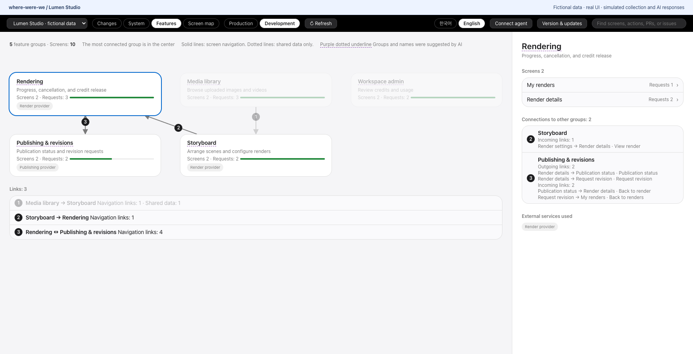

### Screen map and ongoing work

See requests, tests, dev/main differences, overlapping PRs, branches without PRs, local work folders, and linked issues.


### Follow a request

Step through cancellation, provider calls, status changes, and credit release. Background work is distinguished from the request itself.


### Trace connections

Focus on one screen or request and see its callers, data, and external services.

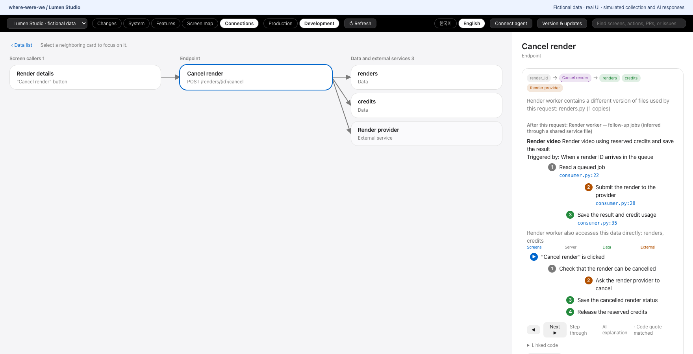

### Shared data impact

Find screens and workers touching the same data. Read/write grouping uses HTTP methods (GET versus other methods), not a semantic analysis of side effects.


### Workers and copied code

Inspect background jobs, directly accessed data, copied files that differ from the source branch, and unverified operational details.

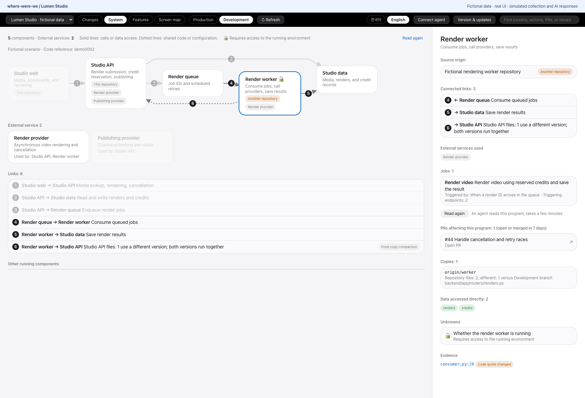

### Find missing test links

Copy a prompt for an agent to locate tests and register repeatable patterns or individual verified lines. Missing links do not establish that tests are absent.

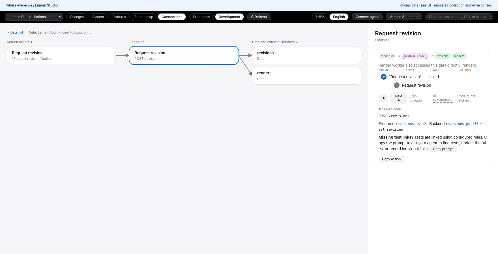

### Connect your agent

Generate MCP registration instructions for the installed runtime. Ask the agent to show proposed configuration edits and request permission.

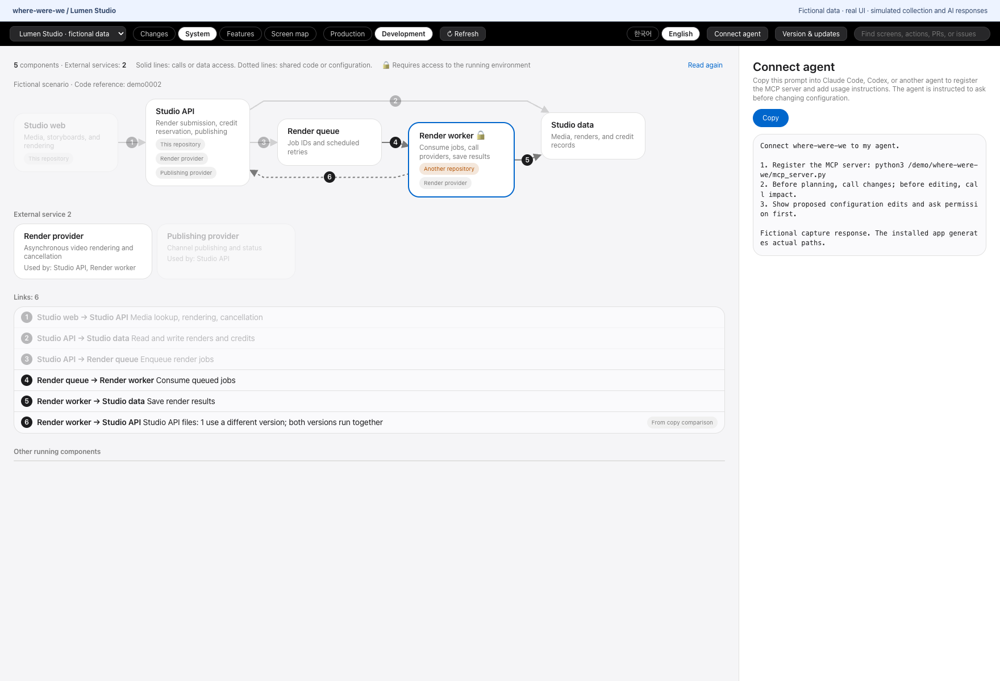

### Versions and updates

View the installed version, stable releases, and bilingual notes; copy the Homebrew upgrade command.

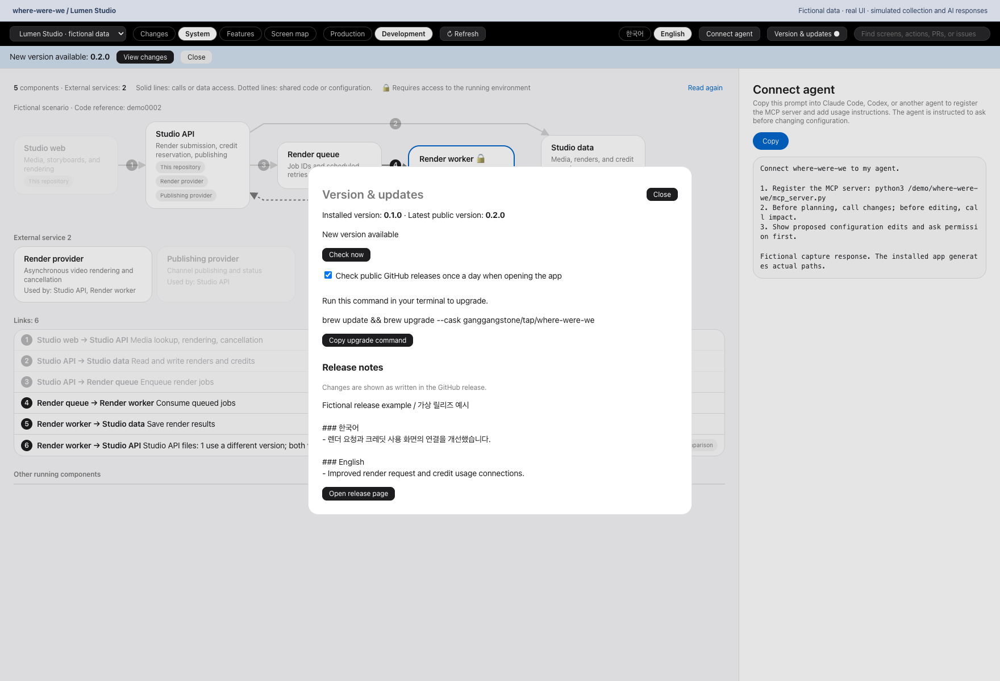

<details>
<summary>More: unresolved links, removed items, and search</summary>

**Server requests with no mapped screen**

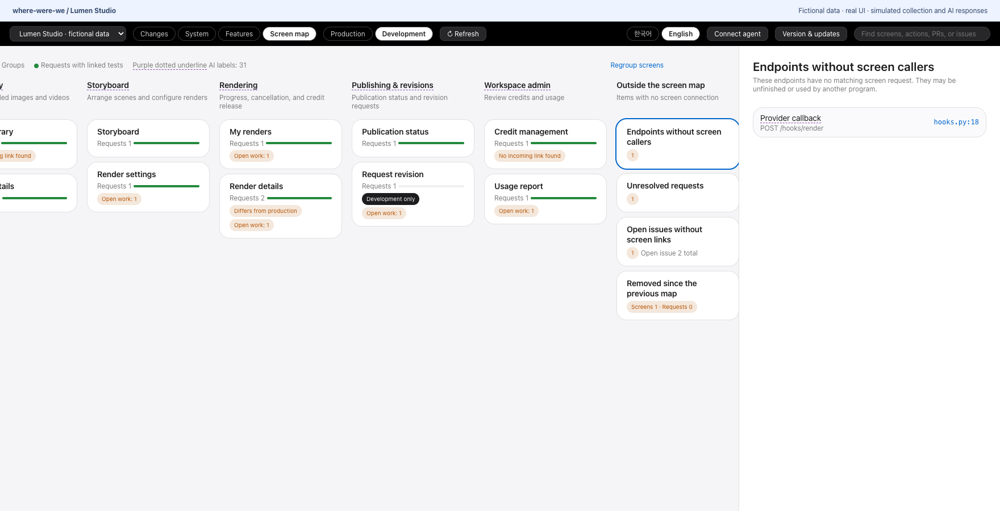

**Requests whose destination cannot be resolved**

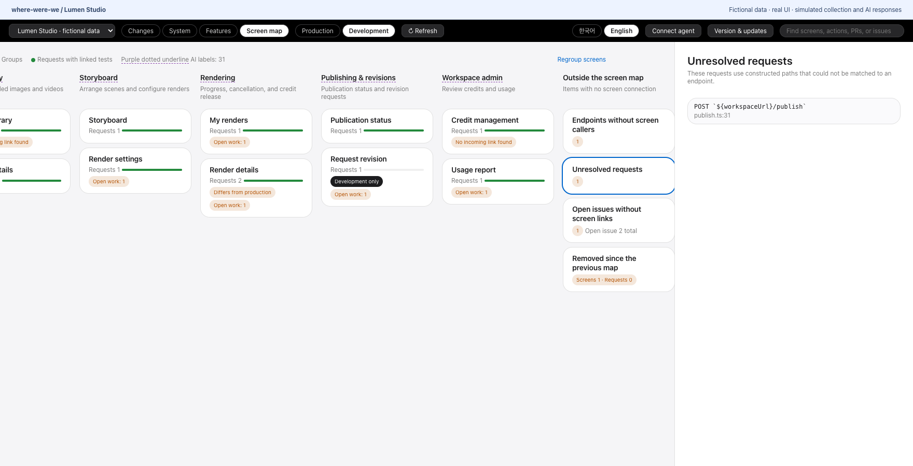

**Issues with no screen link**

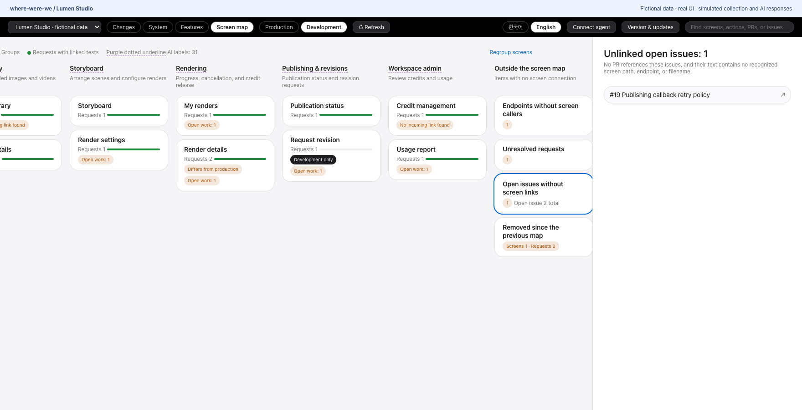

**Screens and requests removed since the previous map**

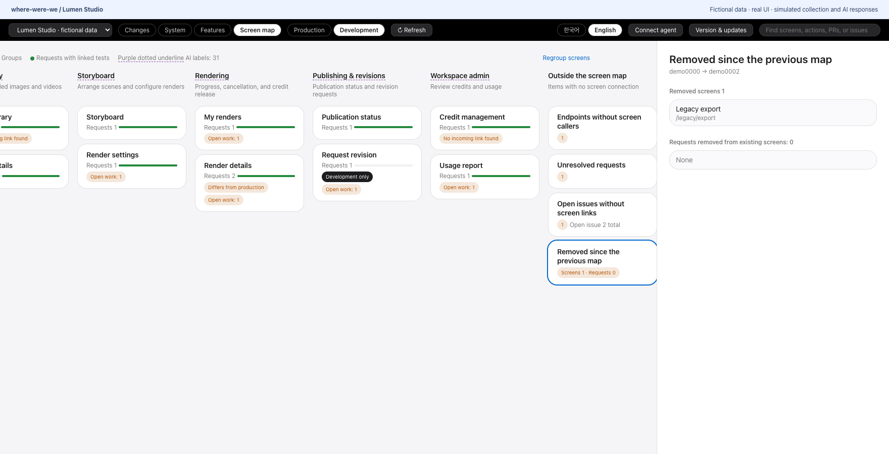

**Search screens, actions, requests, PRs, and issues**

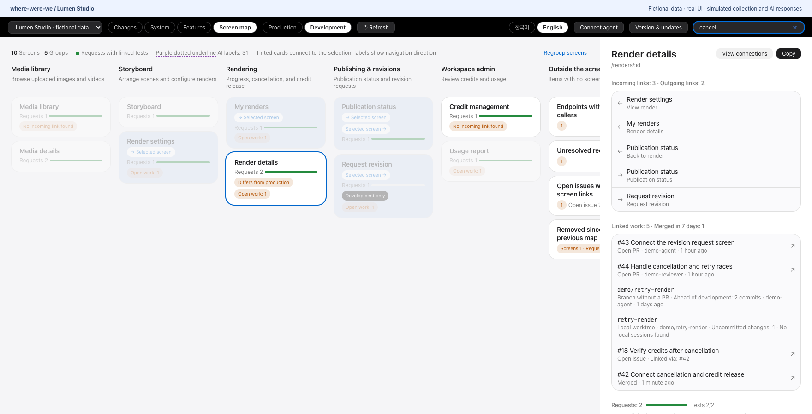

</details>

## Agent workflow

Click **Connect agent**, copy the generated instructions, and give them to Claude Code, Codex, or another MCP client. The instructions request permission before editing configuration and adapt when to check the map to your workflow.

Available tools: `projects`, `changes`, `impact`, `overview`, `find`, `refresh`, `set_test_rules`, and `record_test`. Call `changes` before planning and `impact` before editing to find affected screens, requests, data, and overlapping work. Evidence quotes are checked against the recorded lines; this does not establish the semantic accuracy of an AI explanation or the behavior of the whole system.

## Updates

The app checks the public GitHub release endpoint at most once per 24 hours when opened. You can opt out or check manually. Failed requests preserve previously known information and are never shown as proof that the app is up to date. Release notes are escaped plain text. The request contains no project maps, source code, or GitHub login tokens.

To upgrade, run:

```sh
brew update && brew upgrade --cask ganggangstone/tap/where-were-we
```

The app copies this command; it does not install updates or restart itself. Homebrew may take time to pick up a newly published release. Uninstalling the cask preserves maps in `~/.where-were-we/`.

## Data and limits

- Maps stay in `~/.where-were-we/`. They contain your project's structure; keep them out of public repositories.
- The collector runs `git fetch` and reads local files, git history, GitHub activity, work folders, and available local Claude Code session metadata. It does not check out another branch or modify target repository files.
- Explicitly requested AI actions run your installed `claude -p`. Their input can include source snippets and screen information; processing and transmission follow that client's provider and settings.
- Detailed extraction currently assumes React Router, axios in `frontend/src/api`, FastAPI in `backend/app/routers`, and SQLAlchemy in `backend/app/models`. Other layouts require extractor changes. General structure/PR information is separate from detailed screen extraction.
- `dev` and `main` are code branch comparisons, not a check of what is actually deployed. Programs or runtime facts absent from git remain unverified until someone checks the running system.
- A missing test link or navigation link can mean the extractor does not recognize the pattern. Issue matches marked as candidates and inferred connections remain qualified.

## Develop and build

Source collection needs Python 3.11+ and the external commands listed above:

```sh
git clone https://github.com/ganggangstone/where-were-we.git
cd where-were-we
python3 -m venv .venv
.venv/bin/pip install "mcp>=2,<3"
.venv/bin/python refresh.py my-project /path/to/repository
```

Building the macOS app additionally needs Python 3.12+, Rust, and Tauri CLI 2. Build separately on each architecture; cross-compilation and universal bundles are not supported by the packaging helper.

```sh
python3 scripts/prepare-runtime.py --build --release-preview --target aarch64-apple-darwin --no-sign
```

The helper pins and verifies Python and wheel hashes using [requirements-runtime.lock](requirements-runtime.lock), preserves component license notices, strips build-machine home paths from Rust dependencies, and includes only the backend allowlist. Generated runtimes, personal maps, and build outputs are excluded from git. The command prints the real ZIP digest, cask definition, and bilingual release notes without publishing anything. `--no-sign` produces an unsigned build.

```sh
python3 ui/check_tokens.py
WHERE_WERE_WE_RUNTIME=src-tauri/runtime python3 -m unittest discover -s tests -p test_packaging.py -v
cargo test --manifest-path src-tauri/Cargo.toml --lib
```

Runtime checks relocate the bundle to a path containing spaces and use an empty home and restricted PATH to verify MCP initialization, tool listing, and project listing without a source checkout or system Python. Nested process arguments are tested with subprocess mocks. They do not test collection against a real private project, AI analysis, or changes to a user's agent configuration.

Publish the release ZIP and bilingual notes first, then update [the shared Homebrew tap](https://github.com/ganggangstone/homebrew-tap) using the real digest from [the cask source](Casks/where-were-we.rb). Only publish architectures with a verified artifact. Design conventions live in [DESIGN.md](DESIGN.md).

## Reproduce the demo

[fixture.cjs](docs/demo/fixture.cjs) creates the fictional project in Korean or English. [capture.cjs](docs/demo/capture.cjs) opens the real `ui/` in a browser with mocked Tauri responses. Only the disclosure banner and cursor are added by the capture script. It never reads real project maps or agent settings.

With Node.js and FFmpeg installed:

```sh
npm install --prefix docs/demo --no-save playwright@1.64.0
cd docs/demo && npx playwright install chromium && cd ../..
node docs/demo/capture.cjs --en
node docs/demo/capture.cjs
node docs/demo/capture.cjs --check-language
node docs/demo/capture.cjs --check-updates
```

Each language creates one GIF and 16 PNGs under `docs/images/en/` or `docs/images/ko/`. The GIF follows architecture → features → screen map → cancellation → data impact → changes. Captures fail on browser errors or unexpected external network requests. This verifies mocked rendering and interactions, not real backend responses.

## Contributing and license

Report bugs and propose improvements in [this repository's issues](https://github.com/ganggangstone/where-were-we/issues). Include reproduction steps, expected behavior, and actual behavior. Pull requests to this original project are welcome. Discuss substantial changes you intend to contribute before implementation. A submission does not guarantee a response, acceptance, support, or a release date.

The [custom source-available license](LICENSE) permits personal and internal business use, and free redistribution of original or modified versions under its conditions. It restricts paid products and external paid services. It does not require filing issues, sending PRs, or publishing modification source. This is not MIT, Apache, or an OSI open-source license. Third-party components keep their separate licenses. The English license text is authoritative.

## v0.1.0 release notes

<!-- release-notes:start -->
### 한국어

- 서비스의 프로그램·화면·서버 요청·데이터와 연결된 PR·이슈를 지도에서 확인합니다.
- 한국어 기본 화면과 영어 전환을 지원하며 선택한 언어를 저장합니다. 프로젝트 원문은 유지합니다.
- macOS 앱에 Python과 MCP 실행 환경을 포함합니다. git·GitHub CLI와 AI 기능에 필요한 Claude Code는 별도로 필요합니다.
- 앱에서 새 버전과 한영 릴리즈 노트를 확인하고, Homebrew 업데이트 명령을 복사할 수 있습니다.

### English

- Explore programs, screens, server requests, data, and linked pull requests and issues in a local map.
- Start in Korean or switch to English; your language preference is saved and project content stays verbatim.
- The macOS app includes Python and MCP. Git, GitHub CLI, and Claude Code for AI actions remain external requirements.
- Check new versions and Korean/English release notes in the app, then copy the Homebrew upgrade command.
<!-- release-notes:end -->
