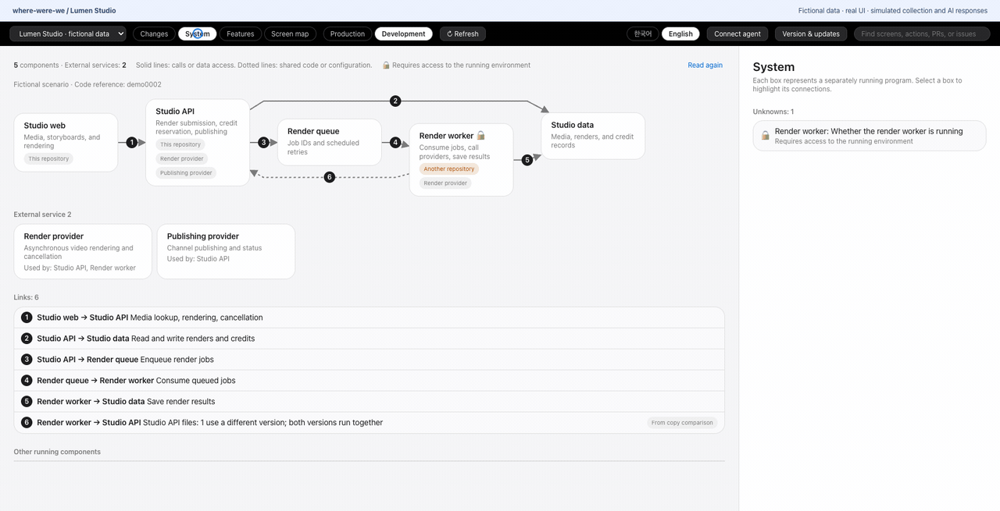
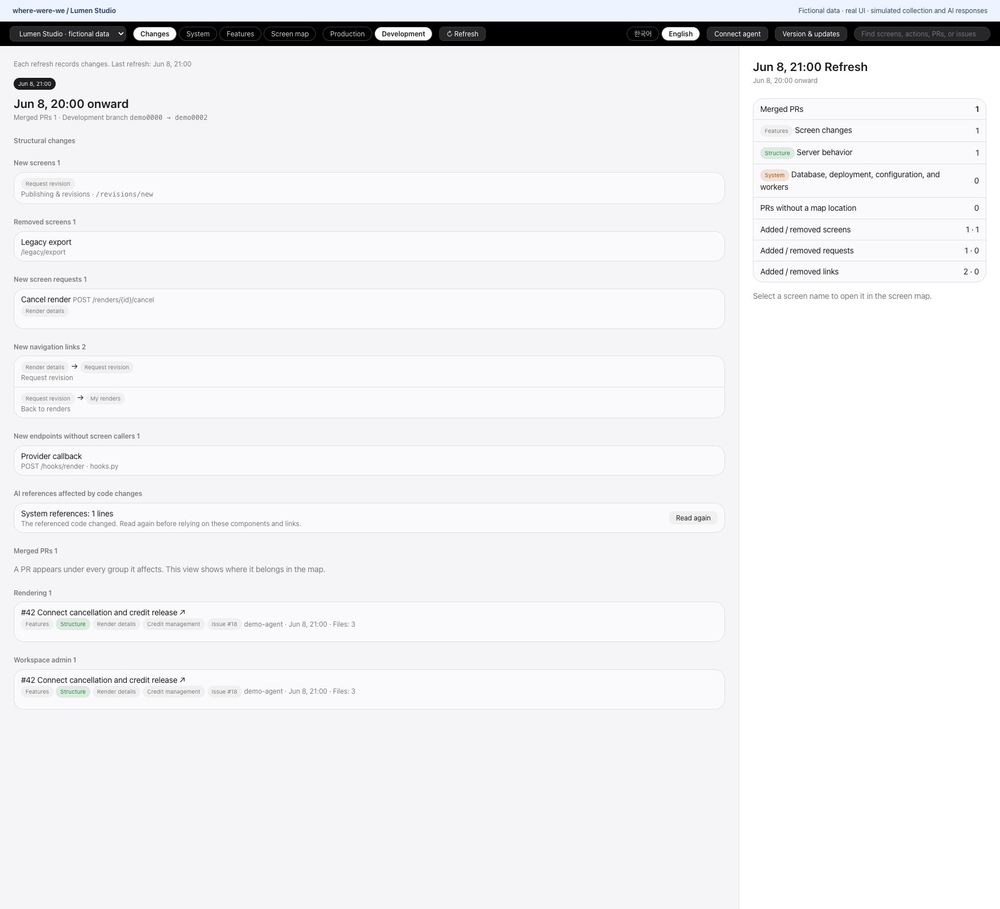
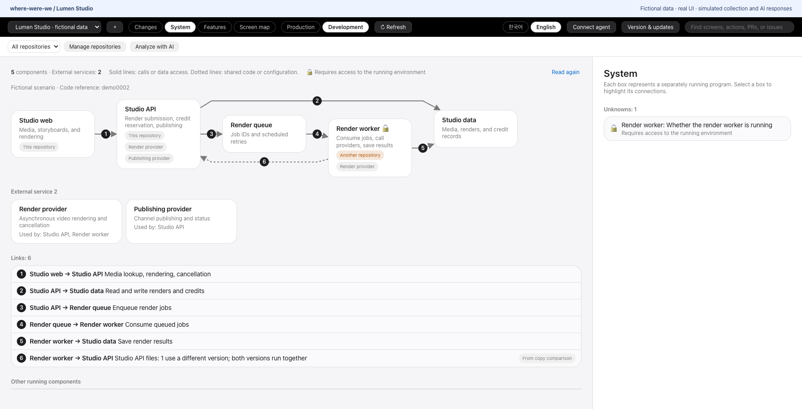
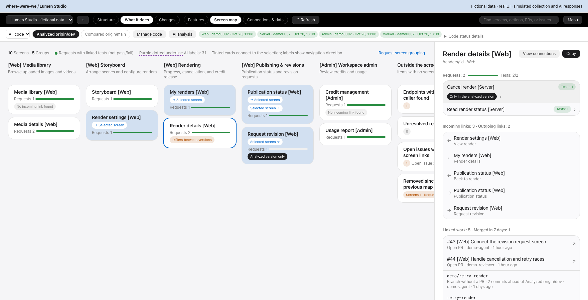
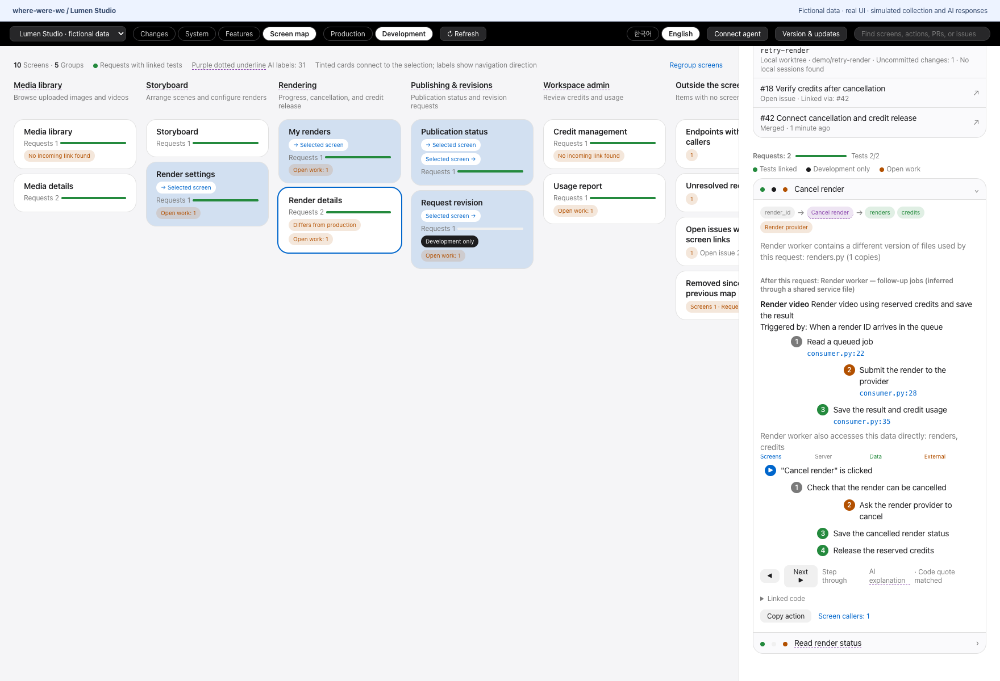
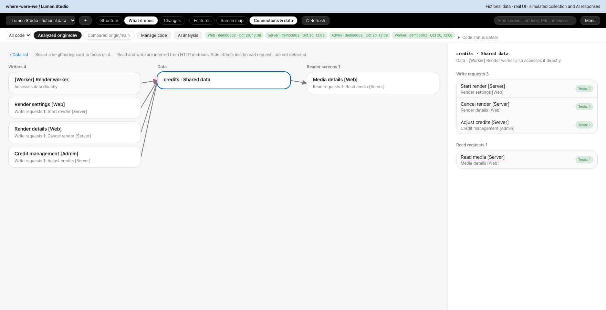

# where-were-we

[English](README.md) · [한국어](README.ko.md)

Explore your codebase with visual architecture maps, change tracking, and impact analysis. Available as a local desktop app and MCP server for AI agents.

Connect several repositories to one project to explore their screens, server requests, programs and shared data. Your AI agent can read the same map and highlight what you are discussing in the app.



Screenshots show the real app with fictional **Lumen Studio** data.

## Install

Requires an Apple Silicon Mac and macOS 11 or later.

```sh
brew install --cask ganggangstone/tap/where-were-we
gh auth login
```

[Homebrew](https://brew.sh/) installs the required Git and GitHub CLI. You can also download the app from [Releases](https://github.com/ganggangstone/where-were-we/releases/latest); ZIP installations need Git and GitHub CLI installed separately.

The app does not have Apple Developer ID signing or notarization. If macOS blocks its first launch, follow Apple's [instructions for opening an app from an unidentified developer](https://support.apple.com/guide/mac-help/open-a-mac-app-from-an-unknown-developer-mh40616/mac).

## Get started

1. Open the app. The **Getting started** guide opens on a new install (reopen it from **Menu → Getting started**).
2. **Ask your AI to connect your service:** copy the instructions into the coding AI chat you build the service with (Claude Code, Codex or another MCP-compatible agent). It sets up its connection after asking you, finds the service's code, and asks you to confirm before saving.
3. In **Connected code**, check each code's location and whether its map is ready. Use **Edit connected code** to fix a saved service; use **Connect manually** (or **＋**) only to enter a new service yourself.
4. GitHub connections collect their first map when connected. For a local folder, click **Refresh**.

With two or more code connections, choose each one's **Server called by this code** in **Connect code** if you know it. This only links them on the map; matching addresses alone do not link different code, and when the app shows candidates you can confirm them with **Link on map**.

GitHub connections follow the remote default branch. Local folders use committed code. Choose other branches or tags under **Map version** when needed. The two **Map version** buttons in the toolbar are labelled with the actual branch or tag names. They compare code, not deployment state.

In **Menu → Settings**, select when the change comparison should start. Settings apply to all services; **Save and refresh** applies them right away. With **Since the previous refresh**, the next refresh compares changes since this refresh; a specific date and time stays fixed until you change it. **Refresh when opening a service** also runs when you switch to another service.

The app starts in Korean. Choose **English** in the **Menu** to save your language preference.

## Use your AI agent

Click **Menu → Connect your AI** and copy the instructions into Claude Code, Codex or another MCP-compatible agent. It sets up the connection and adds usage rules to its global instructions, asking before it changes anything.

With the app open, try: **“Show me the upload retry feature in where-were-we.”** Your agent can find and highlight it, and read what you select in the app. Ask it to consult the map before planning or editing to find affected areas and overlapping work.

For a closer look, choose **Ask your AI → Request all needed analysis**. One request covers the detailed map, architecture and program jobs, screen groups, action steps, and change explanations. Current saved results are reused.

1. Copy the request.
2. Paste it into your coding AI chat and let it analyze the code and save its results.
3. Click **Check results** in the app. After browsing elsewhere, **Ask your AI · waiting for result check** reopens the same request.

Reading saved results preserves **Changes** and its comparison baseline. Your connected AI runs the analysis and its pricing and usage limits apply; ordinary refresh does not run AI analysis.

If tools are missing after an update, open **Connection diagnostics**, copy the repair request to your AI, and click **Check the connection** after it reconnects. You may need a new agent session.

## Explore the map

The three toolbar views are **Structure · What it does · Changes**. **What it does** contains **Features · Screen map · Connections & data**. Search works in every view and finds screens, endpoints, programs, data, features, and PR or issue numbers linked to screens.

### Changes

See changed screens and requests, merged PRs and explanations of what changed and why. Choose **Explain what changed**, paste the request into your AI chat, then **Check results**. These actions keep your comparison baseline unchanged.



### Structure

Programs, queues, shared data, providers, and things that require access to the running system.



An AI proposal saved by your agent never replaces the written structure. Choose **AI proposal** to view it separately.

### Screen map and ongoing work

In **What it does → Screen map**, see requests, tests, differences between the analyzed and compared versions, overlapping PRs, branches without PRs, local work folders, and linked issues.



### Follow a request

Step through cancellation, provider calls, status changes, and credit release. Background work is distinguished from the request itself.



### Shared data impact

Find screens and workers touching the same data.



### More views

Each item links to a screenshot of the same fictional project.

- **Features:** in **What it does → Features**, group screens by purpose and follow connections across features. [Screenshot](docs/images/en/features.png)
- **Connections & data:** in **What it does → Connections & data**, focus on one screen or request and see its callers, data, and external services. [Screenshot](docs/images/en/connections.png)
- **Workers and copied code:** inspect background jobs, directly accessed data, copied files that differ from the source branch, and unverified operational details. [Screenshot](docs/images/en/worker.png)
- **Find missing test links:** **Ask your AI to find tests** copies a request for your AI to locate tests and register repeatable patterns or individual verified lines; it may refresh to check them. Missing links do not establish that tests are absent. [Screenshot](docs/images/en/tests.png)
- **Connect your AI:** in **Menu → Connect your AI**, generate MCP registration instructions for the installed runtime. Ask the agent to show proposed configuration edits and request permission. [Screenshot](docs/images/en/agent-setup.png)
- **Version & updates:** in **Menu → Version & updates**, view the installed version, stable releases, and bilingual notes; install Homebrew updates with **Update now**. [Screenshot](docs/images/en/updates.png)
- **Map gaps:** server requests with no mapped screen ([screenshot](docs/images/en/orphan-requests.png)), requests whose destination cannot be resolved ([screenshot](docs/images/en/unresolved-requests.png)), issues with no screen link ([screenshot](docs/images/en/unlinked-issues.png)), and screens and requests removed since the previous map ([screenshot](docs/images/en/removed-items.png)).
- **Search:** find screens, features, programs, data, PRs and issues from any view once a service has a map. [Screenshot](docs/images/en/search.png)

## Connection help

- **Collection failed:** use **Change GitHub account** to select a saved login and retry. Each code connection remembers its own account; the previous successful map stays available if a refresh fails.
- **Several repositories use one database:** map their table names under **Connect code → When repositories share a database**. Equal table names alone do not connect them.
- **A request belongs to another repository:** choose it under **Server called by this code** in **Connect code**.
- **Disconnecting code:** the downloaded code and saved maps remain on your Mac.

## Updates

Open **Menu → Version & updates** and click **Update now** for Homebrew installations. **View update** in the new-version banner only opens this window. The app closes and reopens after installation; saved maps remain in place. Reconnect your agent's MCP afterward.

To update from a terminal:

```sh
brew update && brew upgrade --cask ganggangstone/tap/where-were-we
```

The app can notify you of new versions. Automatic checks can be turned off in **Menu → Version & updates**. For ZIP installations, download the latest ZIP from [Releases](https://github.com/ganggangstone/where-were-we/releases/latest).

**If an update is interrupted**

The updater attempts to restore the previous app after an installation or startup failure. If recovery is interrupted, open the recovery log:

```sh
open -a TextEdit ~/.where-were-we/.app-update.log
```

It shows the backup location and reinstall command. Restore the backup with Finder or follow that command.


## Your data and analysis coverage

- Maps and downloaded code stay under `~/.where-were-we/`. They describe your project; keep them out of public repositories.
- Collection reads code, Git history and GitHub activity. It fetches updates without switching branches or changing your source files.
- AI analysis provides source code to your connected agent. Its data handling follows the agent/provider settings you choose.
- Automatic extraction supports React Router/axios, FastAPI and SQLAlchemy. Use agent analysis for other languages and frameworks. Check the displayed coverage, unresolved areas and source evidence when interpreting results.
- Branch comparisons describe code, not what is deployed or verified in a running system.

## Contributing and license

Report bugs or suggest improvements in [Issues](https://github.com/ganggangstone/where-were-we/issues). Pull requests are welcome; discuss substantial changes before implementation.

The [license](LICENSE) permits personal use, internal business use, and free redistribution under its conditions. Paid products and external paid services are restricted. This is a custom source-available license; third-party components retain their own licenses.

**v0.5.0 release notes**

<!-- release-notes:start -->
### 한국어

- 처음 안내에서 작업하던 AI에게 서비스 연결을 맡기고, 연결한 코드와 첫 지도를 확인할 수 있습니다.
- 서비스·AI·연결한 코드로 표현을 통일하고, 중복 설명은 상세로 옮겼습니다.
- 분석 요청 복사와 결과 확인을 단계별로 안내합니다. 결과 확인은 바뀐 것의 비교 시작점을 바꾸지 않습니다.
- 변경 설명에서 문제와 바뀐 점을 먼저 보여 주고, 미확인 항목과 두 비교 기간을 구별합니다.
- 기존 서비스의 코드 연결을 바로 수정하고, 코드마다 위치·지도 준비 상태를 확인할 수 있습니다.
- 오류 원인에 맞는 다음 행동을 안내하며, 오류 원문과 복구 위치는 펼쳐 보고 복사할 수 있습니다.
- 한국어·영어 화면의 글자·버튼·메뉴 스타일을 정리하고, 작은 창에서도 시작 안내를 사용할 수 있도록 다듬었습니다.

### English

- Use the getting-started guide to ask your coding AI to connect a service, review its connected code and open the first map.
- Consistent service, AI and connected-code labels replace mixed terminology; repeated explanations move into details.
- Copy analysis requests and check results in clear steps. Checking results preserves the Changes comparison start.
- Change explanations lead with the problem and what changed, with separate unknown items and comparison periods.
- Edit an existing service's code connections and check each location and map readiness.
- Errors explain the next action for their cause, while original messages and recovery locations remain available to open and copy.
- Korean and English typography, buttons and menus are more consistent, and the getting-started guide fits smaller windows.
<!-- release-notes:end -->


[All releases](https://github.com/ganggangstone/where-were-we/releases) · [Configuration and implementation](docs/MULTI_REPO_SPEC.md)
