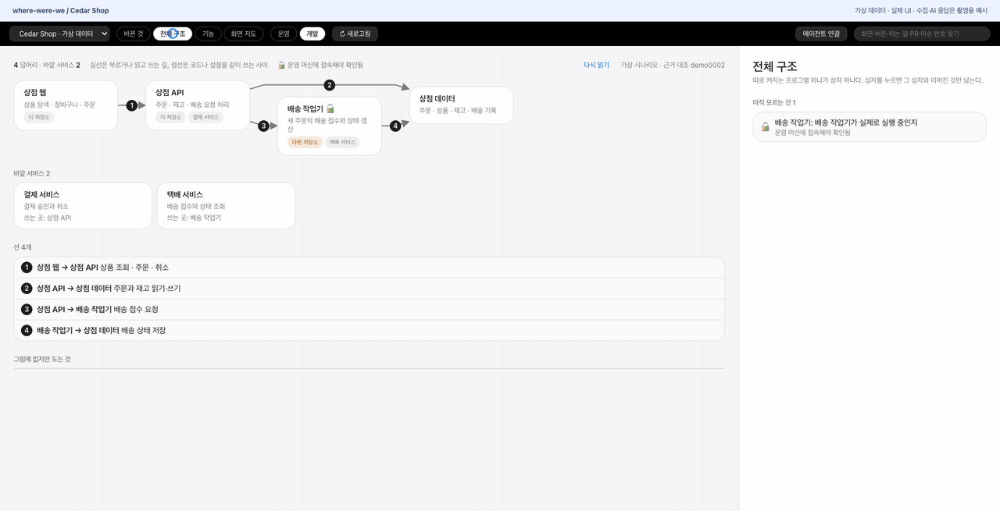
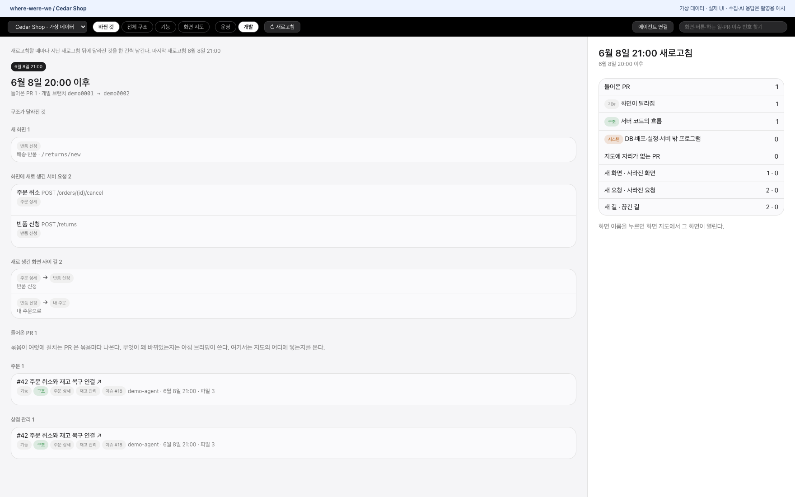
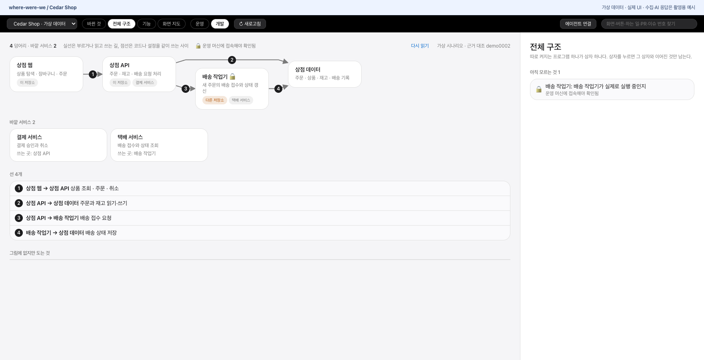
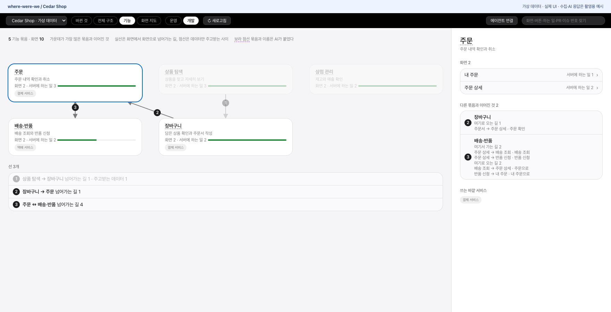
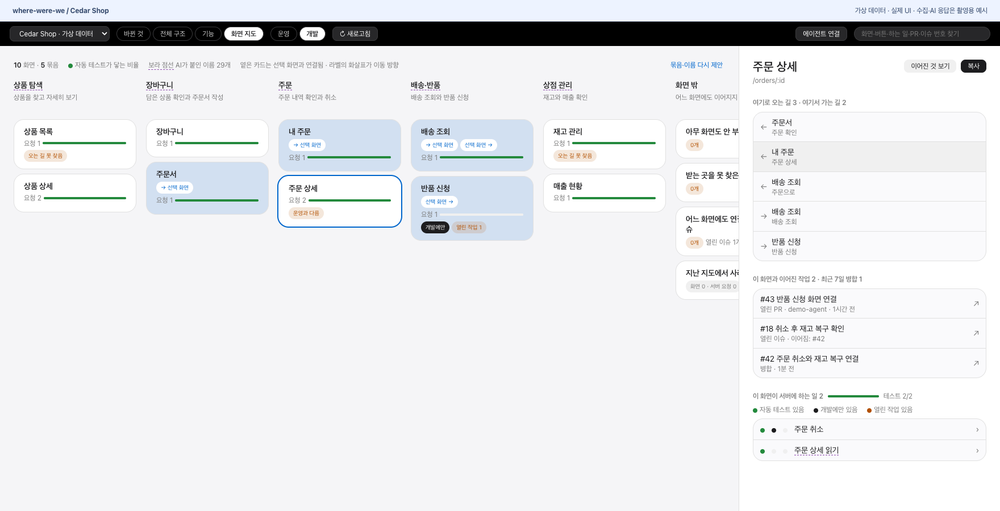
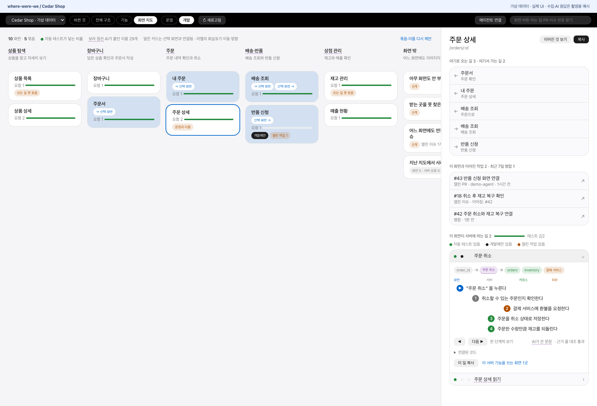
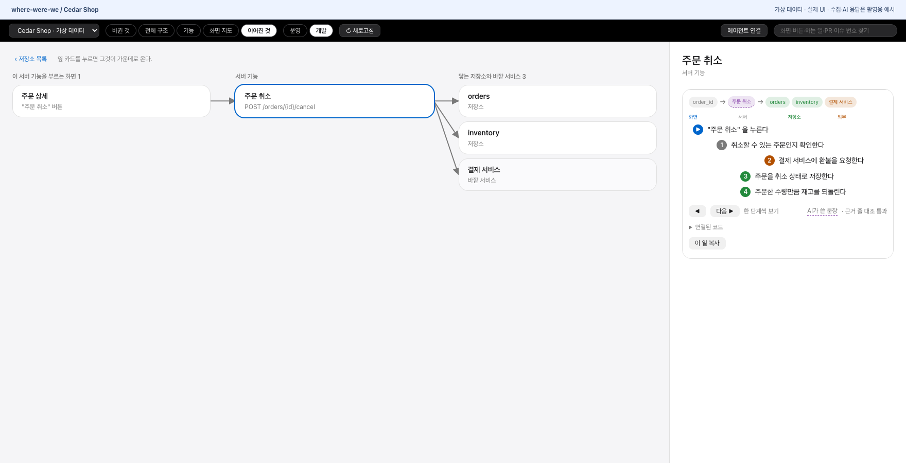
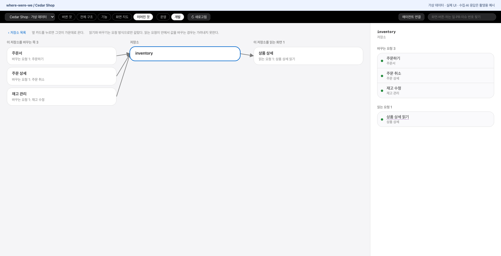
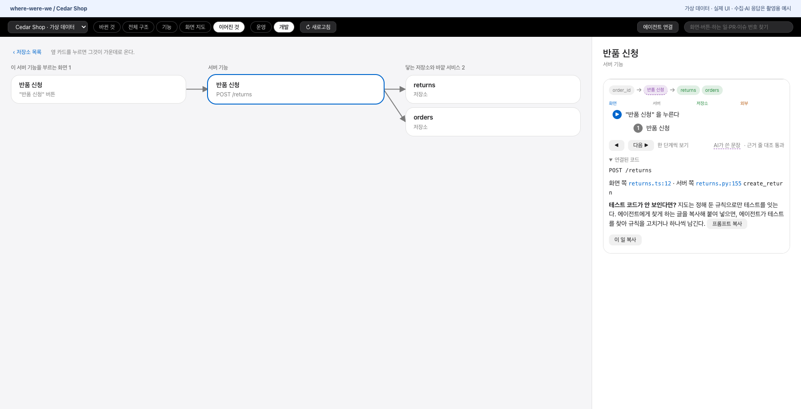
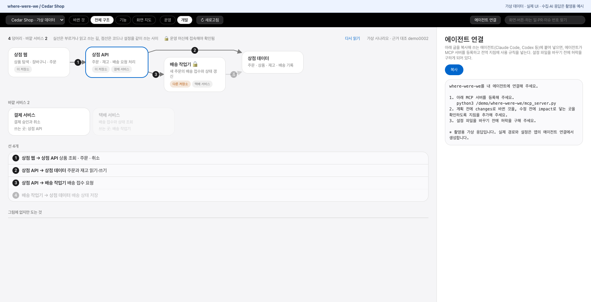

# where-were-we

AI 에이전트가 쉬지 않고 고치는 서비스의 코드를, 사람과 에이전트가 같이 따라가게 돕는 구조 지도입니다.
git과 GitHub를 읽어 서비스가 어떤 프로그램으로 이루어졌는지, 어떤 기능과 화면이 있는지, 버튼을 누르면 서버에서 무슨 일이 일어나는지,
새로고침할 때마다 무엇이 달라졌는지를 보여 줍니다. 같은 지도를 에이전트도 MCP로 읽습니다.



가상 온라인 상점 **Cedar Shop**으로 촬영했습니다. 화면과 클릭 동작은 현재 UI이며, 지도·PR·이슈·테스트 상태·AI 설명·연결 프롬프트는 모두 촬영용 가상 데이터입니다. 실제 저장소 수집, 테스트 실행, AI 분석, MCP 등록은 이 데모에서 실행하지 않습니다.

## 화면

앱은 한국어로 시작합니다. 상단의 **한국어 / English**로 언어를 바꾸면 선택을 이 기기에 저장합니다. 프로젝트에서 읽은 화면 이름·코드·AI 설명과 서버에서 생성한 연결·테스트 안내문은 원문을 유지합니다.

The app starts in Korean. Use **한국어 / English** in the toolbar to switch languages; your preference is saved on this device. Project names, code, AI explanations, and backend-generated setup/test prompts remain in their original language.

| 화면 | 보여 주는 것 |
|---|---|
| 바뀐 것 | 지난 새로고침 뒤에 생기거나 사라진 화면·서버 요청·화면 사이 길, 들어온 PR이 닿는 곳 |
| 전체 구조 | 따로 켜지는 프로그램과 그 사이에 오가는 것, 바깥 서비스, 확인하지 못한 것 |
| 기능 | 화면을 하는 일로 묶은 묶음과 묶음 사이의 길 |
| 화면 지도 | 화면마다 서버에 하는 일, 버튼 뒤에 일어나는 일의 순서, 테스트, 진행 중인 작업 |
| 이어진 것 | 화면·저장소·서버 기능 하나를 가운데 두고 닿는 것만 |

AI가 적은 이름과 문장에는 보라 점선이 붙습니다. AI 설명에 붙은 코드 인용문과 해당 줄이 일치하는지 대조합니다. 이 대조는 설명의 의미나 시스템 전체 동작의 정확성을 보증하지 않습니다.

### 바뀐 것

지난 새로고침 이후 생긴 화면·서버 요청·화면 사이 길과, 병합된 PR이 닿는 기능을 봅니다.



### 전체 구조

웹·API·데이터베이스·배송 작업기가 어떻게 이어지는지 봅니다. 코드만으로 확인할 수 없는 실행 상태도 따로 표시합니다.



### 기능

화면을 하는 일에 따라 묶어 봅니다. 주문을 고르면 어떤 화면이 들어 있고, 다른 기능과 어떤 길·데이터로 연결되는지 나옵니다.



### 화면 지도

화면마다 서버 요청과 테스트 연결 상태를 봅니다. 화면을 고르면 연결된 PR·이슈, 운영·개발 브랜치 사이 차이도 확인할 수 있습니다.



요청을 펼치면 버튼 이후 서버·외부 서비스·데이터에서 일어나는 순서를 한 단계씩 따라갑니다.



### 이어진 것

서버 기능 하나를 가운데 놓고, 부르는 화면과 닿는 데이터·외부 서비스를 봅니다.



데이터를 고르면 그것을 바꾸는 요청과 읽는 요청이 나옵니다.



### 테스트 연결

테스트가 연결되지 않은 요청에는 에이전트가 테스트를 찾게 하는 안내가 나옵니다. 에이전트는 반복되는 모양을 규칙으로 등록하거나 개별 테스트를 연결할 수 있습니다.



### 에이전트 연결

연결 안내를 복사해 쓰는 에이전트에 전달합니다. 에이전트가 MCP 등록과 지침 추가를 도우며, 설정 변경 전에 허락을 구합니다.



## 설치

필요한 것: macOS, Python 3.11 이상, git, [GitHub CLI](https://cli.github.com/)(`gh auth login`), Rust(앱 빌드), 설치된 Claude Code(`claude`, AI가 적는 부분에만 씀).

```
git clone https://github.com/ganggangstone/where-were-we.git && cd where-were-we
python3 -m venv .venv && .venv/bin/pip install "mcp>=2,<3"
python3 extract.py <대상 저장소 경로> origin/dev ~/.where-were-we/<프로젝트 이름>/dev.json
python3 refresh.py <프로젝트 이름>
cd src-tauri && cargo build && ./target/debug/where-were-we
```

전체 구조는 앱의 "전체 구조 만들기" 버튼이 만듭니다(에이전트가 저장소를 몇 분 읽습니다).

### 설치형 앱 빌드 / Packaged macOS app

설치형 앱에는 Python과 MCP 라이브러리, 지도 수집 스크립트가 함께 들어갑니다. 사용자가 Python·Rust나 원본 코드 폴더를 준비할 필요가 없도록 구성합니다. git·GitHub CLI(`gh auth login`)·Claude Code(AI 기능 사용 시)는 별도로 필요합니다. MCP를 실행하는 에이전트의 PATH에서도 이 명령들을 찾을 수 있어야 합니다. 현재 Homebrew 설치 정의와 공개 릴리즈는 준비 전입니다.

The macOS bundle includes Python, MCP dependencies, and the collection scripts. It runs without a source checkout or a separately installed Python/Rust. Git, an authenticated GitHub CLI, and Claude Code for AI actions remain external requirements. The MCP host must also be able to find these commands through its PATH. A public release and Homebrew cask are not available yet.

배포 파일을 만드는 사람은 macOS에서 Python 3.12 이상·Rust·Tauri CLI가 필요합니다. 저장소 루트에서 실행합니다. ARM과 Intel은 각각 해당 머신에서 빌드합니다. 교차 빌드와 universal 빌드는 아직 지원하지 않습니다.

```sh
python3 scripts/prepare-runtime.py --build --target aarch64-apple-darwin
# Intel Mac: use --target x86_64-apple-darwin.
# Local unsigned test build: add --no-sign.
```

위 빌드 명령은 Rust 의존성까지 빌드 머신의 개인 경로를 제거하도록 설정합니다. 배포 파일은 이 명령으로 만드세요. Tauri 빌드 전 단계에서 실행 환경을 준비합니다. 도구는 정해 둔 Python 배포 파일의 SHA-256을 확인하고, [고정 목록](requirements-runtime.lock)의 라이브러리와 해시를 확인해 설치합니다. `src-tauri/runtime/`은 자동으로 만드는 빌드 결과이며 Git에 넣지 않습니다. 지도·개인 설정은 포함하지 않습니다. Python 전체 배포본에서 구성요소별 라이선스 자료도 가져오고, 메타데이터가 참조하지만 원배포 파일에 빠진 zlib-ng 고지는 해당 배포본이 지정한 2.2.4 원문으로 보완합니다. 라이브러리 패키지에 포함된 라이선스 파일도 보존합니다.

```sh
WHERE_WERE_WE_RUNTIME=src-tauri/runtime python3 -m unittest discover -s tests -p test_packaging.py -v
cargo test --manifest-path src-tauri/Cargo.toml
```

패키징 검사는 실행 환경을 공백이 있는 다른 폴더로 옮기고, 빈 홈 폴더와 제한된 PATH에서 연결 안내 생성·MCP 연결·프로젝트 조회를 확인합니다. 하위 Python 실행 인자 검사는 실제 함수의 프로세스 호출을 가짜로 바꿔 확인하며, Rust 검사에서는 포함된 Python을 직접 실행합니다. 실제 저장소 새로고침·AI 분석·사용자 에이전트 설정은 실행하지 않습니다. 코드 서명·공증과 실제 Homebrew 설치는 별도 배포 단계에서 확인해야 합니다.


## 업데이트 / Updates

상단 **버전·업데이트**에서 설치한 버전과 최신 정식 릴리즈, 한국어·영어 변경 내용을 봅니다. 앱을 열 때 하루에 최대 한 번 GitHub의 공개 릴리즈를 확인합니다. 자동 확인을 끄거나 **지금 확인**으로 직접 조회할 수 있습니다. 조회에 실패하면 이전 정보를 유지하고, 실패를 최신 버전이라는 뜻으로 표시하지 않습니다.

Open **Version & updates** to see the installed version, latest stable release, and Korean/English release notes. The app checks public GitHub releases at most once per day when opened. You can turn automatic checks off or check manually. Failed checks keep earlier information and never imply that your app is up to date.

업데이트 설치는 터미널에서 실행합니다. 앱은 명령만 복사합니다. 아래 명령은 공개 릴리즈와 Homebrew 설치 정의를 게시한 뒤 사용할 수 있습니다.

```sh
brew install --cask ganggangstone/tap/where-were-we
brew update && brew upgrade --cask ganggangstone/tap/where-were-we
```

Installation and upgrades use Homebrew. The app only copies the upgrade command. These commands become usable after the release and cask are published. Maps in `~/.where-were-we/` are preserved when uninstalling the app.

버전 조회는 GitHub의 공개 릴리즈 주소만 요청합니다. 요청에 프로젝트 지도·코드·GitHub 로그인 토큰은 넣지 않습니다. 릴리즈 노트는 원문을 일반 텍스트로 보여 줍니다.

The version check requests only the public GitHub release endpoint, without project maps, source code, or GitHub login tokens. Notes are displayed as plain text.

### 배포 준비 / Preparing a release

다음 명령으로 앱을 빌드하고 ZIP·해시·설치 정의 미리보기를 준비합니다. ZIP은 `src-tauri/target/release-assets/`에 두며 도구가 GitHub나 tap에 게시하지 않습니다. 서명·공증과 다른 머신에서의 실행 확인은 배포 전에 별도로 해야 합니다.

```sh
python3 scripts/prepare-runtime.py --build --release-preview --target aarch64-apple-darwin
```

릴리즈 노트 정본은 아래 초안입니다. 같은 버전의 ZIP과 한영 노트를 GitHub 릴리즈로 공개한 뒤, 출력된 해시·설치 정의를 `ganggangstone/homebrew-tap`의 `Casks/where-were-we.rb`에 반영합니다. 설치 정의가 아직 비공개인 ZIP을 가리키지 않게 하는 순서입니다. tap 반영 전까지는 앱에서 새 버전이 보여도 Homebrew가 이전 버전을 유지할 수 있습니다. Intel 파일을 준비하면 실제 해시를 함께 넣어 두 아키텍처의 설치 정의를 만들 수 있습니다. 설치 정의 원본은 [Casks/where-were-we.rb](Casks/where-were-we.rb)에 있습니다. GitHub 릴리즈와 설치용 tap에는 아직 반영하지 않았습니다.

The draft below is the source for release notes. Build and verify the app, publish the GitHub release with its ZIP and both languages, then update `Casks/where-were-we.rb` in `ganggangstone/homebrew-tap` with the actual digest. This keeps the cask from pointing at inaccessible draft assets. Homebrew may retain the previous version until the tap update reaches it. Only architectures with verified release files belong in the cask. The cask source is [Casks/where-were-we.rb](Casks/where-were-we.rb). No GitHub release or cask in the installation tap has been published yet.

### 첫 공개 릴리즈 초안 / First release draft

<!-- release-notes:start -->
### 한국어

- 서비스의 프로그램·화면·서버 요청·데이터와 연결된 PR·이슈를 지도에서 확인합니다.
- 한국어 기본 화면과 영어 전환을 지원하며 선택한 언어를 저장합니다. 프로젝트 원문은 유지합니다.
- macOS 앱에 Python과 MCP 실행 환경을 포함합니다. git·GitHub CLI와 AI 기능에 필요한 Claude Code는 별도로 필요합니다.
- 앱에서 새 버전과 한영 릴리즈 노트를 확인하고, Homebrew 업데이트 명령을 복사할 수 있습니다.

### English

- Explore programs, screens, server requests, data, and linked pull requests and issues in a local map.
- Start in Korean or switch to English; your language preference is saved and project content stays verbatim.
- The macOS app includes Python and MCP. Git, GitHub CLI, and Claude Code for AI actions remain external requirements.
- Check new versions and Korean/English release notes in the app, then copy the Homebrew upgrade command.
<!-- release-notes:end -->

## 에이전트 연결

앱 위쪽의 **에이전트 연결**을 누르고(또는 `.venv/bin/python mapcore.py setup`) 나온 글을 복사해, 쓰는 에이전트(Claude Code, Codex 등)에 붙여 넣으세요.
에이전트가 MCP 서버를 등록하고, 전역 지침에 "계획 전에 바뀐 것을 보고, 고치기 전에 영향을 본다"는 규칙을 넣고, 두 가지를 물어 내 방식에 맞춥니다.
설정 파일을 바꾸기 전에 허락을 구하게 되어 있습니다.

에이전트가 쓰는 도구: `changes`(바뀐 것), `impact`(고치기 전 영향), `overview`(전체 구조), `find`, `refresh`, `projects`, `set_test_rules`, `record_test`.

지도가 서버 기능에 테스트를 잇지 못하면 `impact` 답과 화면 지도에 "테스트 코드가 안 보인다면?" 안내가 붙습니다. 지도는 정해 둔 규칙(기본: `test_*.py` 파일 안의 `client.<method>("<path>")`)으로만 테스트를 찾기 때문입니다. 안내를 받은 에이전트는 저장소에서 테스트를 찾아, 되풀이되는 모양이면 `set_test_rules`로 규칙을 고치고, 한 곳뿐인 것은 `record_test`로 줄과 글자를 넘깁니다. 규칙과 기록은 `~/.where-were-we/<프로젝트>/tests.json`에 남고, 기록은 새로 뽑을 때마다 그 줄에 그 글자가 아직 있는지 다시 대조합니다.

## 지키는 것

- 대상 저장소에는 `git fetch` 말고 아무것도 쓰지 않습니다. 다른 브랜치는 체크아웃하지 않고 `git show`로 읽습니다.
- 지도는 `~/.where-were-we/`에만 둡니다. 회사 코드의 구조가 담기니 어느 저장소에도 올리지 마세요.
- AI 기능은 설치된 Claude Code(`claude -p`)를 실행하며, 코드 일부나 화면 정보가 입력에 포함됩니다. 해당 정보의 처리·전송은 Claude Code가 연결한 서비스와 설정을 따릅니다. AI 기능은 앱의 해당 버튼이나 관련 명령을 명시적으로 실행할 때 호출합니다.

## 한계

- 화면 지도를 뽑는 `extract.py`는 React Router + axios(`frontend/src/api`) + FastAPI(`backend/app/routers`) + SQLAlchemy(`backend/app/models`) 구조를 가정합니다. 다른 기술의 프로젝트는 전체 구조와 PR·이슈만 나옵니다.
- 운영 서버에만 있는 것(저장소에 없는 프로그램, 실제로 켜져 있는지)은 "운영 머신에 접속해야 확인됨"으로 남습니다.

## Contributing / 기여 안내

### English

- Report bugs and propose improvements in the [original repository's issues](https://github.com/ganggangstone/where-were-we/issues). For bugs, include reproduction steps, expected behavior, and what happened instead.
- Send improvements useful to other users as pull requests to `ganggangstone/where-were-we`. Forking the repository is one way to prepare a pull request; you do not need to publish a separate product.
- For substantial changes you intend to contribute to the original project, discuss the scope in an issue before implementation. Submitting an issue or pull request does not guarantee a response, acceptance, or a release date.

Use and redistribution are governed by the [project license](LICENSE). It permits personal and internal business use and free redistribution under its conditions, and restricts paid products and external paid services. This is a custom source-available license, not MIT or Apache. Third-party components retain their separate licenses.

### 한국어

- 버그와 개선 제안은 [원본 저장소의 이슈](https://github.com/ganggangstone/where-were-we/issues)로 보내 주세요. 버그는 재현 순서, 기대한 동작, 실제로 일어난 일을 함께 적어 주세요.
- 다른 사용자도 쓸 수 있는 개선은 `ganggangstone/where-were-we`에 PR로 보내 주세요. 포크는 PR을 준비하는 방법 중 하나이며, 별도 제품으로 배포할 필요는 없습니다.
- 원본 프로젝트에 기여하려는 큰 변경은 구현 전에 이슈에서 범위를 논의해 주세요. 이슈·PR을 보냈다고 답변·반영·출시 일정이 보장되지는 않습니다.

사용·재배포에는 [프로젝트 라이선스](LICENSE)가 적용됩니다. 정해진 조건에 따라 개인·회사 내부 사용과 무료 재배포를 허용하고, 유료 제품·외부 유료 서비스를 제한합니다. MIT·Apache가 아닌 별도의 소스 공개 라이선스입니다. 제삼자 구성 요소의 별도 라이선스는 유지됩니다.

## 데모 다시 촬영하기

가상 데이터는 [fixture.cjs](docs/demo/fixture.cjs), 촬영 도구는 [capture.cjs](docs/demo/capture.cjs)에 있습니다. 도구는 현재 `ui/` 파일을 브라우저에서 열고 Tauri 응답을 가짜 데이터로 대신합니다. 실제 프로젝트 지도나 에이전트 설정은 읽지 않습니다. 위쪽의 가상 데이터 표시와 커서만 촬영 도구가 추가합니다.

Node.js와 FFmpeg가 설치된 환경에서 저장소 루트에서 실행합니다. Playwright는 촬영 도구에만 필요합니다.

```sh
npm install --prefix docs/demo --no-save playwright@1.64.0
cd docs/demo && npx playwright install chromium && cd ../..
node docs/demo/capture.cjs
```

`docs/images/`의 GIF 1개와 PNG 9개를 다시 만듭니다. GIF는 전체 구조 → 기능 → 화면 지도 → 주문 취소 → 데이터 영향 → 바뀐 것 순서입니다. 촬영 중 브라우저 오류가 발생하거나 외부 네트워크 요청을 시도하면 실패합니다. 이 검사는 가짜 응답으로 화면이 그려지고 클릭이 연결되는 범위만 확인합니다.

